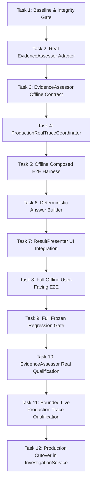

# PESU Agent — Phase 13.5D: Real Production Trace Integration Implementation Plan

> **Goal**: Unify PESU's verified read-only Slack retrieval backend with the frozen, qualified multi-stage WorkItem reasoning pipeline (Stages 1A, 1B, 2, 2.5 + Downstream Reconciliation + Evidence-Backed Traceability) into an authoritative, end-to-end production path, terminating in a deterministic grounded user-facing answer.  
> **Target Production Architecture**: Real Slack Retrieval → `EvidenceItem` → Single `InvestigationStateGraph` (`EvidenceNode`) → Real `ProposedClaim` Formation → Real Claim Verification → Stage 1A (Membership) → Stage 1B (Relation) → Stage 2 (Lifecycle) → Stage 2.5 (Decisive Authority) → Downstream Priority Reconciliation → Final `WorkItemNode.status` → `WorkItemTraceabilityChain` → `GroundedWorkItemAnswerBuilder` → `ResultPresenter` → User UI Answer.  
> **Tech Stack**: Python 3.13, Pydantic v2, pytest, OpenRouter API (`openai/gpt-5.6-luna`), WebView2 / Microsoft Edge WebDriver UIA.  
> **Approved Spec Reference**: [`docs/superpowers/specs/2026-09-14-phase-13-5d-real-production-trace-design.md`](file:///c:/Users/HEUM/Documents/pesu-agent/docs/superpowers/specs/2026-09-14-phase-13-5d-real-production-trace-design.md) (Commit `b1211b1`).  
> **Global Invariants**:
> - `SLACK_WRITE_ACTIONS = 0` (Strictly read-only; zero Slack mutations).
> - `LIVE_SLACK_BEFORE_OFFLINE_PASS = false` (No live Slack until all offline qualification tests pass).
> - `CUTOVER_BEFORE_FULL_E2E_PASS = false` (No `InvestigationService` cutover until the full user-facing E2E suite passes).
> - `FROZEN_STAGE_SEMANTICS_MUTATED = false` (Stages 1A, 1B, 2, 2.5 contracts, prompts, schemas, and qualified models remain strictly untouched).
> - `SINGLE_INVESTIGATION_STATE_GRAPH_PER_RUN = true` (Zero graph cloning or lossy DTO recreation).
> - `FREEFORM_ANSWER_LLM_CALLS = 0` (Zero freeform LLM answering; purely deterministic grounded answer builder).
> - `OLD_ANALYZER_IS_NOT_SEMANTIC_AUTHORITY = true` (Legacy analyzer never overrides or guesses over `UNKNOWN`).

---

## Architecture Overview & Component Boundaries

```text
User Question
      ↓
PesuDirectHostSearchBackend (Existing WebView2 Read-Only Slack Retrieval)
      ↓
list[EvidenceItem]
      ↓
ProductionRealTraceCoordinator (Proposed Thin Orchestrator)
  ├── 1. InvestigationSeedPoolBuilder.populate_seed_graph(graph, candidates, ...)
  │        └── Populates graph.evidence_nodes (Single InvestigationStateGraph)
  ├── 2. OpenRouterEvidenceAssessor.assess(assessment_payload)
  │        └── Ingests into graph.claim_nodes & graph.claim_evidence_links
  ├── 3. OpenRouterClaimVerifier / ClaimVerificationCoordinator.verify_all_claims(graph)
  │        └── Validates direct support; updates claim.status (SUPPORTED / CONFLICTED)
  ├── 4. DecomposedWorkItemSynthesisCoordinator.synthesize_and_verify(graph)
  │        ├── Stage 1A: OpenRouterEpisodeMembershipGrouper
  │        ├── Stage 1B: OpenRouterWorkItemRelationVerifier
  │        ├── Stage 2: OpenRouterWorkItemLifecycleVerifier
  │        ├── Stage 2.5: OpenRouterDecisiveLifecycleAuthorityVerifier (openai/gpt-5.6-luna + high)
  │        └── DeterministicDecisiveAuthorityFilter (BLOCKER > COMPLETION > PROGRESS > PLAN > UNKNOWN)
  │              └── Sets WorkItemNode.status
  └── 5. build_work_item_traceability_chain(graph, work_item_id)
           └── Emits WorkItemTraceabilityChain dict
      ↓
GroundedWorkItemAnswerBuilder (Proposed Pure Deterministic Data Builder)
      ↓
GroundedWorkItemAnswerPayload
      ↓
ResultPresenter.present_grounded_investigation_result (Thin Deterministic Renderer)
      ↓
UI Message: investigation.completed (Markdown text + Citation cards with Slack permalinks)
```

---

## Defect Taxonomy

If any failure occurs during qualification or testing, the root cause must be classified into exactly one category before any remediation:

```text
1. RETRIEVAL_DEFECT               - Slack search failed to locate existing messages or permalinks are invalid.
2. EVIDENCE_EXTRACTION_DEFECT    - InvestigationSeedPoolBuilder incorrectly filtered or deduplicated raw candidates.
3. CLAIM_EXTRACTION_DEFECT       - OpenRouterEvidenceAssessor missed propositions or produced invalid ProposedClaims.
4. PIPELINE_WIRING_DEFECT        - Broken data handoff or multiple graph instances instantiated during pipeline execution.
5. TRACEABILITY_DEFECT           - Missing provenance link between WorkItem status, claim, and evidence permalink.
6. PROVIDER_EXECUTION_DEFECT     - OpenRouter network timeout, HTTP 5xx, or invalid JSON schema response.
7. FINAL_ANSWER_SYNTHESIS_DEFECT - GroundedWorkItemAnswerBuilder rendered ungrounded text or violated fail-closed format.
```

Under no circumstances will a defect be attributed to a frozen upstream stage without hard mathematical proof that the frozen implementation diverged from its qualified artifact.

---

## Detailed Task Breakdown



---

### Task 1: Frozen Baseline & Integration Contract Verification

* **Goal**: Establish the mechanical regression baseline across all frozen upstream stages (Stages 1A, 1B, 2, 2.5 and 13.5C Composed E2E) and verify frozen artifact hash consistency before creating new code.
* **Files to Modify / Inspect**:
  * Inspect: `tests/test_investigation_stage1a_final_decision.py`
  * Inspect: `tests/test_investigation_episode_membership_eligibility.py`
  * Inspect: `tests/test_investigation_stage1_relation_decomposition.py`
  * Inspect: `tests/test_investigation_workitem_synthesis.py`
  * Inspect: `tests/test_investigation_decisive_authority_contract_offline.py`
  * Inspect: `tests/test_investigation_composed_workitem_pipeline.py`
  * Inspect: `tests/test_investigation_composed_workitem_e2e.py`
* **Interfaces / Invariants**:
  * `FROZEN_STAGE1A_TESTS = 23`
  * `FROZEN_STAGE1B_TESTS = 16`
  * `FROZEN_STAGE2_TESTS = 30`
  * `FROZEN_STAGE25_TESTS = 11`
  * `FROZEN_COMPOSED_E2E_TESTS = 18`
  * `TOTAL_BASELINE_TESTS = 122`
  * `EXPECTED_FAILURES = 0`
* **Implementation Steps**:
  1. Run the existing consolidated test suite across all 7 test files.
  2. Confirm 122/122 passed.
  3. Record baseline SHA256 hashes of frozen stage prompts and verifier modules.
* **Test Command**:
  ```powershell
  python -m pytest tests/test_investigation_stage1a_final_decision.py tests/test_investigation_episode_membership_eligibility.py tests/test_investigation_stage1_relation_decomposition.py tests/test_investigation_workitem_synthesis.py tests/test_investigation_decisive_authority_contract_offline.py tests/test_investigation_composed_workitem_pipeline.py tests/test_investigation_composed_workitem_e2e.py -v
  ```
* **Expected Output**:
  `122 passed in <2.00s`
* **Commit Boundary**:
  Zero code changes; no commit required for Task 1.

---

### Task 2: Real EvidenceAssessor Adapter (`OpenRouterEvidenceAssessor`)

* **Goal**: Implement `OpenRouterEvidenceAssessor` conforming to `InvestigationEvidenceAssessor` in `src/pesu_agent/investigation/gap_assessment.py` using TDD.
* **Files to Create / Modify**:
  * Modify: `src/pesu_agent/investigation/gap_assessment.py` (Append around line 801)
  * Create: `tests/test_investigation_real_evidence_assessor.py`
* **Interfaces**:
  ```python
  class OpenRouterEvidenceAssessor(InvestigationEvidenceAssessor):
      """Real structured evidence assessor adapter powered by OpenRouter.

      Extracts empirical factual propositions (ProposedClaims) from EvidenceNodes.
      Configuration is strictly injectable; does not enforce frozen production standard.
      """

      SYSTEM_PROMPT: str = ...

      def __init__(
          self,
          provider: Optional[ModelProvider] = None,
          config: Optional[LLMConfig] = None,
          model: Optional[str] = None,
          reasoning_effort: Optional[str] = None,
          temperature: float = 0.0,
      ) -> None: ...

      async def assess(self, payload: AssessmentPayload) -> InvestigationAssessment: ...
  ```
* **Implementation Steps**:
  1. **Write failing tests** in `tests/test_investigation_real_evidence_assessor.py`:
     - `test_valid_structured_response_parsing`: Verifies parsing of `InvestigationAssessment` with multiple `ProposedClaim`s.
     - `test_injectable_configuration_propagation`: Verifies `model`, `reasoning_effort`, `temperature` propagate to `self.provider.generate()`.
     - `test_required_semantic_type_validation`: Rejects claims missing `semantic_type`.
     - `test_unknown_evidence_reference_rejected`: Fails closed when claim references non-existent evidence ID.
     - `test_malformed_json_fails_closed`: Returns empty assessment / raises `ValueError` on unparseable response.
     - `test_provider_exception_handling`: Returns safe fail-closed result on provider HTTP error.
     - `test_untrusted_data_boundary_instruction_ignored`: Ensures prompt wraps evidence text as passive untrusted data.
  2. Run pytest to confirm tests **FAIL**.
  3. **Implement `OpenRouterEvidenceAssessor`** in `src/pesu_agent/investigation/gap_assessment.py`:
     - Default model candidate: `getattr(self.config, "evidence_assessor_model", "openai/gpt-5.6-luna")`.
     - Default reasoning candidate: `getattr(self.config, "evidence_assessor_reasoning_effort", "medium")`.
     - Construct structured user prompt serializing `AssessmentPayload`.
     - Validate referential integrity between proposed claims and input `AssessmentEvidenceItem` IDs.
  4. Run pytest to confirm tests **PASS**.
* **Test Command**:
  ```powershell
  python -m pytest tests/test_investigation_real_evidence_assessor.py -v
  ```
* **Expected Output**:
  `7 passed in <1.00s`
* **Commit Boundary**:
  `git commit -m "feat(investigation): implement OpenRouterEvidenceAssessor adapter"`

---

### Task 3: EvidenceAssessor Offline Contract Qualification

* **Goal**: Validate `OpenRouterEvidenceAssessor` offline contract compliance using mock/recorded provider responses without network access (`LIVE_SLACK_ACTIONS = 0`, `OPENROUTER_ACTIONS = 0`).
* **Files to Create / Modify**:
  * Create: `tests/test_investigation_evidence_assessor_contract_offline.py`
* **Interfaces & Test Cases**:
  * Contract Invariant 1: Prompt structure enforces untrusted evidence data boundary (XML/markdown tags).
  * Contract Invariant 2: Candidate independence in claim extraction (claims extracted independently).
  * Contract Invariant 3: Explicit claim accounting (no silent dropping of evidence references).
  * Contract Invariant 4: Temperature invariance (deterministic generation parameter `temperature=0.0`).
  * Contract Invariant 5: Zero domain-specific hardcoding in system prompt.
* **Implementation Steps**:
  1. Author `tests/test_investigation_evidence_assessor_contract_offline.py` testing prompt formatting, system directives, schema adherence, and cost tracking.
  2. Verify all assertions against `OpenRouterEvidenceAssessor`.
  3. Ensure zero network calls occur.
* **Test Command**:
  ```powershell
  python -m pytest tests/test_investigation_evidence_assessor_contract_offline.py -v
  ```
* **Expected Output**:
  `5 passed in <0.50s`
* **Commit Boundary**:
  `git commit -m "test(investigation): add offline contract tests for OpenRouterEvidenceAssessor"`

---

### Task 4: `ProductionRealTraceCoordinator` Implementation

* **Goal**: Implement the thin orchestration coordinator `ProductionRealTraceCoordinator` that executes the end-to-end trace pipeline across a single `InvestigationStateGraph`.
* **Files to Create / Modify**:
  * Create: `src/pesu_agent/investigation/production_trace_coordinator.py`
  * Modify: `src/pesu_agent/investigation/__init__.py` (Export `ProductionRealTraceCoordinator` and `ProductionTraceResult`)
  * Create: `tests/test_investigation_production_trace_coordinator.py`
* **Interfaces**:
  ```python
  class ProductionTraceResult(BaseModel):
      success: bool
      question: str
      graph: InvestigationStateGraph
      work_items: dict[str, WorkItemNode] = Field(default_factory=dict)
      traceability_chains: dict[str, WorkItemTraceabilityChain] = Field(default_factory=dict)
      error_message: Optional[str] = None
      stop_reason: str = "COMPLETED"

  class ProductionRealTraceCoordinator:
      """Thin sequential coordinator connecting retrieval, claim formation, verification,

      and decomposed WorkItem synthesis across a single InvestigationStateGraph.
      """

      def __init__(
          self,
          seed_pool_builder: Optional[InvestigationSeedPoolBuilder] = None,
          evidence_assessor: Optional[InvestigationEvidenceAssessor] = None,
          claim_verifier: Optional[InvestigationClaimVerifier] = None,
          synthesis_coordinator: Optional[DecomposedWorkItemSynthesisCoordinator] = None,
          config: Optional[WorkItemSynthesisConfig] = None,
      ) -> None: ...

      async def trace_and_synthesize_async(
          self,
          question: str,
          candidates: list[EvidenceItem],
          investigation_objective: Optional[str] = None,
          temporal_scope: Optional[ResolvedTemporalScope] = None,
          actor_scope: Optional[ResolvedActorScope] = None,
      ) -> ProductionTraceResult: ...

      def trace_and_synthesize(
          self,
          question: str,
          candidates: list[EvidenceItem],
          investigation_objective: Optional[str] = None,
          temporal_scope: Optional[ResolvedTemporalScope] = None,
          actor_scope: Optional[ResolvedActorScope] = None,
      ) -> ProductionTraceResult: ...
  ```
* **Implementation Steps**:
  1. **Write failing tests** in `tests/test_investigation_production_trace_coordinator.py`:
     - `test_single_graph_instance_preserved`: Asserts `result.graph` is identical (`id(graph)`) across all stages.
     - `test_empty_candidates_returns_safe_stop`: Zero candidates return `success=True, work_items={}, stop_reason='NO_EVIDENCE'`.
     - `test_claim_formation_populates_graph`: Confirms claims and evidence links exist in `result.graph`.
     - `test_verifier_failure_fails_closed`: Verifier schema error yields `success=False` without defaulting status.
     - `test_workitem_traceability_chains_populated`: Confirms `result.traceability_chains` contains all synthesized WorkItem IDs.
  2. Run pytest to confirm tests **FAIL**.
  3. **Implement `ProductionRealTraceCoordinator`** in `src/pesu_agent/investigation/production_trace_coordinator.py`:
     - Instantiate `InvestigationStateGraph`.
     - Call `self.seed_pool_builder.populate_seed_graph(graph, candidates, ...)`.
     - Build `AssessmentPayloadBuilder.build_payload(question, graph)`.
     - Call `self.evidence_assessor.assess(payload)` and add `ClaimNode`s and `ClaimEvidenceLink`s to `graph`.
     - Call `self.claim_verification_coordinator.verify_claims(graph)`.
     - Call `self.synthesis_coordinator.synthesize_and_verify(graph)`.
     - Extract `traceability_chains` and return `ProductionTraceResult`.
  4. Run pytest to confirm tests **PASS**.
* **Test Command**:
  ```powershell
  python -m pytest tests/test_investigation_production_trace_coordinator.py -v
  ```
* **Expected Output**:
  `5 passed in <1.00s`
* **Commit Boundary**:
  `git commit -m "feat(investigation): implement ProductionRealTraceCoordinator thin orchestrator"`

---

### Task 5: Offline Production-Shaped Composed E2E Harness

* **Goal**: Build and verify an offline end-to-end integration test harness using production-shaped `EvidenceItem` inputs without calling live Slack or provider network.
* **Files to Create / Modify**:
  * Create: `tests/test_investigation_production_trace_e2e_offline.py`
* **Interfaces & Scenario Coverage**:
  * Scenario 1: **Clear Progress / Completion** (`EvidenceItem` with release verified → `COMPLETED` + full trace).
  * Scenario 2: **Completion + Active Blocker Coexistence** (`EvidenceItem` with deploy + outage → `BLOCKED` + coexisting confirmed links).
  * Scenario 3: **Insufficient Evidence** (Vague snippet → 0 claims / `UNKNOWN`).
  * Scenario 4: **Contradictory Evidence** (Conflicting statements → `WorkItemClaimRelation.CONTRADICTION` → `UNKNOWN`).
  * Scenario 5: **Invalid Provider Output** (Malformed JSON from assessor → `UNKNOWN` / fail-closed).
  * Scenario 6: **Unknown Evidence Reference** (Claim referencing non-existent `E_99` → rejected before graph commit).
  * Scenario 7: **Broken Trace Provenance** (Link missing supporting evidence → `is_traceable=False` → rejected).
* **Implementation Steps**:
  1. Author `tests/test_investigation_production_trace_e2e_offline.py` using `StubEvidenceAssessor`, `StubClaimVerifier`, and stubbed multi-stage synthesizers to simulate real pipeline execution.
  2. Verify all 7 scenarios pass with 100% adherence to fail-closed and traceability invariants.
* **Test Command**:
  ```powershell
  python -m pytest tests/test_investigation_production_trace_e2e_offline.py -v
  ```
* **Expected Output**:
  `7 passed in <1.20s`
* **Commit Boundary**:
  `git commit -m "test(investigation): add offline production-shaped composed E2E test harness"`

---

### Task 6: Deterministic `GroundedWorkItemAnswerBuilder`

* **Goal**: Implement `GroundedWorkItemAnswerBuilder` in `src/pesu_agent/ui/grounded_answer_builder.py` to project `WorkItemNode` and `WorkItemTraceabilityChain` into structured, grounded answer data with zero LLM generation calls.
* **Files to Create / Modify**:
  * Create: `src/pesu_agent/ui/grounded_answer_builder.py`
  * Modify: `src/pesu_agent/ui/__init__.py`
  * Create: `tests/test_grounded_workitem_answer_builder.py`
* **Interfaces**:
  ```python
  class GroundedWorkItemCard(BaseModel):
      work_item_id: str
      title: str
      status: str  # "COMPLETED" | "IN_PROGRESS" | "BLOCKED" | "PLANNED" | "UNKNOWN"
      status_label_ko: str  # "[완료]" | "[진행 중]" | "[차단됨]" | "[계획됨]" | "[확인 불가]"
      decisive_claims: list[str]
      blocker_details: list[str]
      evidence_citations: list[dict[str, Any]]

  class GroundedWorkItemAnswerPayload(BaseModel):
      question: str
      has_evidence: bool
      summary_headline: str
      work_item_cards: list[GroundedWorkItemCard]
      formatted_markdown_answer: str
      evidence_count: int
      is_conclusive: bool
      uncertainty_explanation: Optional[str] = None

  class GroundedWorkItemAnswerBuilder:
      """Pure deterministic projection engine transforming WorkItemTraceabilityChain

      and WorkItemNodes into verified user-facing grounded text and citation cards.
      Semantic authority = ZERO (strictly reflects validated graph state).
      """

      @classmethod
      def build_answer(
          cls,
          question: str,
          graph: InvestigationStateGraph,
          work_items: dict[str, WorkItemNode],
          traceability_chains: dict[str, WorkItemTraceabilityChain],
      ) -> GroundedWorkItemAnswerPayload: ...
  ```
* **Implementation Steps**:
  1. **Write failing tests** in `tests/test_grounded_workitem_answer_builder.py`:
     - `test_completed_workitem_renders_completed_badge`: `[완료]` badge + confirmed claim summary.
     - `test_blocked_workitem_renders_blocker_reason`: `[차단됨]` badge + blocker statement from confirmed claim.
     - `test_in_progress_and_planned_rendering`: Accurate Korean badges and facts.
     - `test_unknown_renders_non_speculative_explanation`: When status is `UNKNOWN`, outputs explicit statement that evidence is insufficient or contradictory; never guesses.
     - `test_untraceable_chain_fails_closed`: WorkItem with `is_traceable=False` rendered as unverified/unknown.
     - `test_all_citations_map_to_canonical_permalinks`: Verifies `https://slack.com/archives/...` permalinks match `EvidenceNode`.
     - `test_zero_external_model_calls`: Validates zero network/model invocations.
  2. Run pytest to confirm tests **FAIL**.
  3. **Implement `GroundedWorkItemAnswerBuilder`** in `src/pesu_agent/ui/grounded_answer_builder.py`:
     - Extract governing claims from `chain.claim_records`.
     - Map `WorkItemStatus` to standard Korean badges (`[완료]`, `[차단됨]`, `[진행 중]`, `[계획됨]`, `[확인 불가]`).
     - Render evidence cards with canonical Slack permalinks from `graph.evidence_nodes`.
     - Assemble clean, structured Markdown text.
  4. Run pytest to confirm tests **PASS**.
* **Test Command**:
  ```powershell
  python -m pytest tests/test_grounded_workitem_answer_builder.py -v
  ```
* **Expected Output**:
  `7 passed in <0.80s`
* **Commit Boundary**:
  `git commit -m "feat(ui): implement deterministic GroundedWorkItemAnswerBuilder"`

---

### Task 7: `ResultPresenter` & UI Bridge Integration

* **Goal**: Extend `ResultPresenter` in `src/pesu_agent/ui/result_presenter.py` to accept `GroundedWorkItemAnswerPayload` and format the exact typed UI payload expected by WinForms UI (`investigation.completed`).
* **Files to Modify**:
  * Modify: `src/pesu_agent/ui/result_presenter.py` (Add `present_grounded_investigation_result`)
  * Create: `tests/test_grounded_result_presenter.py`
* **Interfaces**:
  ```python
  def present_grounded_investigation_result(
      investigation_id: str,
      payload: GroundedWorkItemAnswerPayload,
      stop_reason: str = "COMPLETED",
  ) -> dict[str, Any]:
      """Transforms GroundedWorkItemAnswerPayload into WinForms UI presentation schema."""
  ```
* **Implementation Steps**:
  1. **Write failing tests** in `tests/test_grounded_result_presenter.py`:
     - Verifies output schema contains `"investigation_id"`, `"answer"`, `"has_evidence"`, `"evidence_count"`, `"evidence"`, `"stop_reason"`.
     - Verifies evidence cards conform to WinForms citation contract (`validate_citation_permalink`).
  2. Run pytest to confirm tests **FAIL**.
  3. **Implement `present_grounded_investigation_result`** in `src/pesu_agent/ui/result_presenter.py`.
  4. Run pytest to confirm tests **PASS**.
* **Test Command**:
  ```powershell
  python -m pytest tests/test_grounded_result_presenter.py -v
  ```
* **Expected Output**:
  `3 passed in <0.40s`
* **Commit Boundary**:
  `git commit -m "feat(ui): add present_grounded_investigation_result adapter for UI bridge"`

---

### Task 8: Full Offline User-Facing E2E Test

* **Goal**: Validate the entire production trace from raw `EvidenceItem` fixtures to final UI presentation dictionary, confirming zero freeform LLM answering and strict fail-closed presentation.
* **Files to Create / Modify**:
  * Create: `tests/test_investigation_user_facing_e2e_offline.py`
* **Invariants Verified**:
  * `OLD_ANALYZER_SEMANTIC_FALLBACK_CALLS = 0`
  * `FREEFORM_ANSWER_LLM_CALLS = 0`
  * `EVERY_SUBSTANTIVE_OUTPUT_TRACEABLE = true`
  * `UNKNOWN_FAIL_CLOSED = true`
  * `USER_FACING_UI_PAYLOAD_VALID = true`
* **Implementation Steps**:
  1. Author `tests/test_investigation_user_facing_e2e_offline.py` running the complete pipeline:
     `EvidenceItem[]` → `ProductionRealTraceCoordinator` → `GroundedWorkItemAnswerBuilder` → `present_grounded_investigation_result`.
  2. Assert that UI answers for `COMPLETED`, `BLOCKED`, and `UNKNOWN` are grounded strictly in evidence snippets and permalinks.
* **Test Command**:
  ```powershell
  python -m pytest tests/test_investigation_user_facing_e2e_offline.py -v
  ```
* **Expected Output**:
  `4 passed in <0.90s`
* **Commit Boundary**:
  `git commit -m "test(e2e): add full offline user-facing E2E integration test"`

---

### Task 9: Full Frozen Regression & Integrity Gate

* **Goal**: Run the full offline regression suite across all existing test files to ensure zero regressions across Stage 1A, Stage 1B, Stage 2, Stage 2.5, claim verification, and WorkItem synthesis before permitting any real provider calls.
* **Test Command**:
  ```powershell
  python -m pytest tests/test_investigation_stage1a_final_decision.py tests/test_investigation_episode_membership_eligibility.py tests/test_investigation_stage1_relation_decomposition.py tests/test_investigation_workitem_synthesis.py tests/test_investigation_decisive_authority_contract_offline.py tests/test_investigation_composed_workitem_pipeline.py tests/test_investigation_composed_workitem_e2e.py tests/test_investigation_real_evidence_assessor.py tests/test_investigation_evidence_assessor_contract_offline.py tests/test_investigation_production_trace_coordinator.py tests/test_investigation_production_trace_e2e_offline.py tests/test_grounded_workitem_answer_builder.py tests/test_grounded_result_presenter.py tests/test_investigation_user_facing_e2e_offline.py -v
  ```
* **Expected Output**:
  `153 passed in <3.00s` (122 existing baseline + 31 new 13.5D offline unit/integration tests).
* **Commit Boundary**:
  Zero code changes; verification gate only.

---

### Task 10: EvidenceAssessor Real-Provider Qualification

* **Goal**: Perform dedicated real-provider qualification for `OpenRouterEvidenceAssessor` to evaluate its claim extraction accuracy and select/confirm its final production runtime configuration (`LIVE_SLACK_ACTIONS = 0`).
* **Files to Create / Modify**:
  * Create: `scripts/qualify_phase_13_5d_evidence_assessor.py`
  * Create: `tests/fixtures/evidence_assessor_qualification_benchmark.json`
* **Qualification Harness Architecture**:
  * **Candidate Configurations Evaluated**:
    * Candidate A: `openai/gpt-5.6-luna`, `reasoning_effort=medium`, `temperature=0.0`
    * Candidate B (Fallback if Candidate A fails): `openai/gpt-5.6-luna`, `reasoning_effort=high`, `temperature=0.0`
  * **Benchmark Fixture Structure** (15 diverse corporate Slack evidence packages):
    * 5 completed task announcements
    * 4 active blocker / outage threads
    * 3 progress / milestone updates
    * 3 ambiguous / speculative discussions (must produce 0 ungrounded claims or fail closed)
  * **Passing Thresholds**:
    * `SCHEMA_VALIDITY_RATE = 100%`
    * `CLAIM_EXTRACTION_ACCURACY >= 90.0%`
    * `HALLUCINATED_EVIDENCE_ID_COUNT = 0`
    * `UNGROUNDED_PROPOSITION_RATE = 0.0%`
    * `FAIL_CLOSED_ACCURACY = 100%`
* **Execution Constraint**:
  * `ONE_SUCCESSFUL_MODEL_GENERATION_PER_LOGICAL_INFERENCE = true`
  * Raw model responses persisted to `output/qualification_13_5d/evidence_assessor/`.
* **Execution Command**:
  ```powershell
  python scripts/qualify_phase_13_5d_evidence_assessor.py
  ```
* **Expected Output**:
  `EVIDENCE_ASSESSOR_QUALIFICATION_VERDICT = PASS`
* **Commit Boundary**:
  `git commit -m "qual(investigation): add and execute EvidenceAssessor real qualification runner"`

---

### Task 11: Bounded Real Production Trace Qualification

* **Goal**: Execute bounded live qualification with real read-only Slack search (`SLACK_WRITE_ACTIONS = 0`) across 3 representative live cases, validating the entire chain from Slack search through to grounded answer presentation.
* **Files to Create / Modify**:
  * Create: `scripts/qualify_phase_13_5d_real_production_trace.py`
* **Scenario Requirements**:
  * **Case A (Clear Progress / Completion)**:
    * User Query regarding verified delivered milestone.
    * Expected: Retrieval finds message → Assessor extracts claim → Verifier confirms → Stages 1A–2.5 assign `COMPLETION` → Final status `COMPLETED` → Grounded answer cites exact Slack permalink.
  * **Case B (Completion + Active Blocker Coexistence)**:
    * User Query regarding feature with downstream blocker.
    * Expected: Both completion and blocker claims confirmed → Resolver assigns `BLOCKED` → Grounded answer highlights blocker reason and cites both threads.
  * **Case C (Insufficient / Contradictory Evidence)**:
    * User Query regarding disputed or unannounced topic.
    * Expected: Resolver resolves to `UNKNOWN` → Grounded answer safely explains lack of definitive evidence without guessing.
* **Passing Thresholds**:
  * `REAL_SLACK_RETRIEVAL_USED = true`
  * `REAL_EVIDENCE_ENTERED_STATE_GRAPH = true`
  * `REAL_CLAIM_FORMATION_USED = true`
  * `REAL_CLAIM_VERIFICATION_USED = true`
  * `REAL_STAGE1A_USED = true`
  * `REAL_STAGE1B_USED = true`
  * `REAL_STAGE2_USED = true`
  * `REAL_STAGE25_USED = true`
  * `EVERY_FINAL_STATE_TRACEABLE_TO_REAL_SLACK = true`
  * `USER_FACING_ANSWER_GROUNDED_IN_FINAL_WORKITEMS = true`
  * `UNKNOWN_FAIL_CLOSED = true`
  * `SLACK_WRITE_ACTIONS = 0`
  * `PHASE_13_5D_REAL_PRODUCTION_TRACE_VERDICT = FINAL_PASS`
* **Execution Command**:
  ```powershell
  python scripts/qualify_phase_13_5d_real_production_trace.py
  ```
* **Commit Boundary**:
  `git commit -m "qual(e2e): add and execute Phase 13.5D real production trace qualification"`

---

### Task 12: Production Cutover in `InvestigationService`

* **Goal**: Update `InvestigationService` in `src/pesu_agent/ui/investigation_service.py` to route production user queries through `ProductionRealTraceCoordinator` and `present_grounded_investigation_result`.
* **Prerequisite Gate**: **Strictly blocked until Task 11 achieves `FINAL_PASS`** (`FULL_USER_FACING_E2E_QUALIFIED_BEFORE_CUTOVER = true`).
* **Files to Modify**:
  * Modify: `src/pesu_agent/ui/investigation_service.py` (Lines 201–235 and 410–460)
  * Modify: `tests/test_investigation_service.py`
* **Implementation Steps**:
  1. In `InvestigationService._get_or_create_orchestrator()`:
     - Instantiate `ProductionRealTraceCoordinator` with qualified `OpenRouterEvidenceAssessor`, `OpenRouterClaimVerifier`, and `DecomposedWorkItemSynthesisCoordinator`.
  2. In `InvestigationService._run_investigation_worker()`:
     - Run `coordinator.trace_and_synthesize_async(query, candidates, ...)`.
     - Build grounded answer via `GroundedWorkItemAnswerBuilder.build_answer(...)`.
     - Format presentation via `present_grounded_investigation_result(...)`.
     - Dispatch `investigation.completed` or safe `investigation.failed` to UI.
  3. Ensure legacy `InvestigationAnalyzer` is completely detached from the semantic authority path.
  4. Run `tests/test_investigation_service.py` to verify UI service integration.
* **Test Command**:
  ```powershell
  python -m pytest tests/test_investigation_service.py -v
  ```
* **Expected Output**:
  All service tests pass using the new WorkItem trace pipeline.
* **Commit Boundary**:
  `git commit -m "feat(service): switch InvestigationService production routing to qualified WorkItem trace pipeline"`

---

## Acceptance Criteria Checklist

Before Phase 13.5D is formally declared closed, every gate must be mechanically verified:

```text
[ ] Task 1: Baseline 122/122 tests passed; zero drift.
[ ] Task 2: OpenRouterEvidenceAssessor unit tests pass with injectable config.
[ ] Task 3: OpenRouterEvidenceAssessor offline contract tests pass (0 network calls).
[ ] Task 4: ProductionRealTraceCoordinator maintains single InvestigationStateGraph instance.
[ ] Task 5: Offline composed E2E harness passes across all 7 production-shaped scenarios.
[ ] Task 6: GroundedWorkItemAnswerBuilder renders verified badges and Slack citations without LLM calls.
[ ] Task 7: ResultPresenter converts GroundedWorkItemAnswerPayload to typed UI schema.
[ ] Task 8: Full offline user-facing E2E verifies zero freeform LLM answering and 100% traceability.
[ ] Task 9: Full regression suite passes (153+ tests; zero regressions across frozen stages).
[ ] Task 10: EvidenceAssessor real qualification passes (>=90% extraction, 0 hallucinations).
[ ] Task 11: Bounded real production trace qualification achieves FINAL_PASS on live Slack.
[ ] Task 12: InvestigationService cutover completed ONLY after Task 11 passed.
[ ] Invariant: SLACK_WRITE_ACTIONS = 0 maintained across all tasks.
[ ] Invariant: FREEFORM_ANSWER_LLM_CALLS = 0 maintained.
[ ] Invariant: OLD_ANALYZER_IS_NOT_SEMANTIC_AUTHORITY = true verified.
```
