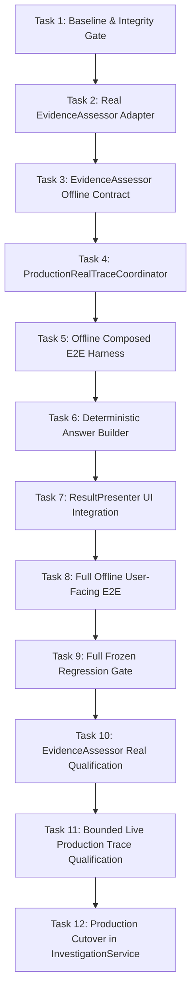

# PESU Agent — Phase 13.5D: Real Production Trace Integration Implementation Plan

> **Goal**: Unify PESU's verified read-only Slack retrieval backend with the frozen, qualified multi-stage WorkItem reasoning pipeline (Stages 1A, 1B, 2, 2.5 + Downstream Reconciliation + Evidence-Backed Traceability) into an authoritative, end-to-end production path, terminating in a deterministic grounded user-facing answer.  
> **Target Production Architecture**: Real Slack Retrieval → `EvidenceItem` → Single `InvestigationStateGraph` (`EvidenceNode`) → Real `ProposedClaim` Formation → Real Claim Verification → Stage 1A (Membership) → Stage 1B (Relation) → Stage 2 (Lifecycle) → Stage 2.5 (Decisive Authority) → Downstream Priority Reconciliation → Final `WorkItemNode.status` → `WorkItemTraceabilityChain` → `GroundedWorkItemAnswerBuilder` → `ResultPresenter` → User UI Answer.  
> **Tech Stack**: Python 3.13, Pydantic v2, pytest, OpenRouter API (`openai/gpt-5.6-luna`), WebView2 / Microsoft Edge WebDriver UIA.  
> **Approved Spec Reference**: [`docs/superpowers/specs/2026-09-14-phase-13-5d-real-production-trace-design.md`](file:///c:/Users/HEUM/Documents/pesu-agent/docs/superpowers/specs/2026-09-14-phase-13-5d-real-production-trace-design.md) (Commit `b1211b1`).  
> **Global Invariants**:
> - `SLACK_WRITE_ACTIONS = 0` (Strictly read-only; zero Slack mutations).
> - `LIVE_SLACK_BEFORE_OFFLINE_PASS = false` (No live Slack until all offline qualification tests pass).
> - `CUTOVER_BEFORE_FULL_E2E_PASS = false` (No `InvestigationService` cutover until the full user-facing E2E suite passes).
> - `FROZEN_STAGE_SEMANTICS_MUTATED = false` (Stages 1A, 1B, 2, 2.5 contracts, prompts, schemas, and qualified models remain strictly untouched).
> - `SINGLE_INVESTIGATION_STATE_GRAPH_PER_RUN = true` (Zero graph cloning or lossy DTO recreation).
> - `FREEFORM_ANSWER_LLM_CALLS = 0` (Zero freeform LLM answering; purely deterministic grounded answer builder).
> - `OLD_ANALYZER_IS_NOT_SEMANTIC_AUTHORITY = true` (Legacy analyzer never overrides or guesses over `UNKNOWN`).

---

## Architecture Overview & Component Boundaries

```text
User Question
      ↓
PesuDirectHostSearchBackend (Existing WebView2 Read-Only Slack Retrieval)
      ↓
list[EvidenceItem]
      ↓
ProductionRealTraceCoordinator (Proposed Thin Orchestrator)
  ├── 1. InvestigationSeedPoolBuilder.populate_seed_graph(graph, candidates, ...)
  │        └── Populates graph.evidence_nodes (Single InvestigationStateGraph)
  ├── 2. OpenRouterEvidenceAssessor.assess(assessment_payload)
  │        └── Ingests into graph.claim_nodes & graph.claim_evidence_links
  ├── 3. OpenRouterClaimVerifier / ClaimVerificationCoordinator.verify_all_claims(graph)
  │        └── Validates direct support; updates claim.status (SUPPORTED / CONFLICTED)
  ├── 4. DecomposedWorkItemSynthesisCoordinator.synthesize_and_verify(graph)
  │        ├── Stage 1A: OpenRouterEpisodeMembershipGrouper
  │        ├── Stage 1B: OpenRouterWorkItemRelationVerifier
  │        ├── Stage 2: OpenRouterWorkItemLifecycleVerifier
  │        ├── Stage 2.5: OpenRouterDecisiveLifecycleAuthorityVerifier (openai/gpt-5.6-luna + high)
  │        └── DeterministicDecisiveAuthorityFilter (BLOCKER > COMPLETION > PROGRESS > PLAN > UNKNOWN)
  │              └── Sets WorkItemNode.status
  └── 5. build_work_item_traceability_chain(graph, work_item_id)
           └── Emits WorkItemTraceabilityChain dict
      ↓
GroundedWorkItemAnswerBuilder (Proposed Pure Deterministic Data Builder)
      ↓
GroundedWorkItemAnswerPayload
      ↓
ResultPresenter.present_grounded_investigation_result (Thin Deterministic Renderer)
      ↓
UI Message: investigation.completed (Markdown text + Citation cards with Slack permalinks)
```

---

## Defect Taxonomy

If any failure occurs during qualification or testing, the root cause must be classified into exactly one category before any remediation:

```text
1. RETRIEVAL_DEFECT               - Slack search failed to locate existing messages or permalinks are invalid.
2. EVIDENCE_EXTRACTION_DEFECT    - InvestigationSeedPoolBuilder incorrectly filtered or deduplicated raw candidates.
3. CLAIM_EXTRACTION_DEFECT       - OpenRouterEvidenceAssessor missed propositions or produced invalid ProposedClaims.
4. PIPELINE_WIRING_DEFECT        - Broken data handoff or multiple graph instances instantiated during pipeline execution.
5. TRACEABILITY_DEFECT           - Missing provenance link between WorkItem status, claim, and evidence permalink.
6. PROVIDER_EXECUTION_DEFECT     - OpenRouter network timeout, HTTP 5xx, or invalid JSON schema response.
7. FINAL_ANSWER_SYNTHESIS_DEFECT - GroundedWorkItemAnswerBuilder rendered ungrounded text or violated fail-closed format.
```

Under no circumstances will a defect be attributed to a frozen upstream stage without hard mathematical proof that the frozen implementation diverged from its qualified artifact.

---

## Detailed Task Breakdown



---

### Task 1: Frozen Baseline & Integration Contract Verification

* **Goal**: Establish the mechanical regression baseline across all frozen upstream stages (Stages 1A, 1B, 2, 2.5 and 13.5C Composed E2E), compute the authoritative SHA256 baseline manifest across all frozen implementation and fixture files before any implementation starts, and seal it into the qualification artifact directory.
* **Files to Inspect & Verify**:
  * Authoritative Stage Implementations & Pipeline Logic:
    * `src/pesu_agent/investigation/workitem_synthesis.py` (Contains Stage 1A EpisodeGrouper, Stage 1B RelationVerifier, Stage 2 LifecycleVerifier, Stage 2.5 DecisiveAuthorityVerifier, and synthesis coordinators)
    * `src/pesu_agent/investigation/claim_verification.py` (Contains ClaimVerifier and ClaimVerificationCoordinator)
    * `src/pesu_agent/investigation/graph_models.py` (Core InvestigationStateGraph, WorkItemNode, ClaimNode, EvidenceNode schemas)
    * `src/pesu_agent/investigation/context_expansion.py` (InvestigationSeedPoolBuilder)
    * `tests/qualification_support/workitem_evaluator.py` (Authoritative qualification evaluator contracts and thresholds)
  * Authoritative Frozen Fixtures & Benchmarks:
    * `tests/fixtures/workitem_episode_membership_r3a_r3_fixtures.py` (Stage 1A qualified benchmark)
    * `tests/fixtures/workitem_relation_r3b_r2_fixtures.py` (Stage 1B qualified benchmark)
    * `tests/fixtures/workitem_lifecycle_ar2_fixtures.py` (Stage 2 qualified benchmark)
    * `tests/fixtures/workitem_decisive_authority_r3c_v10_fixtures.py` (Stage 2.5 qualified V10 benchmark)
    * `tests/fixtures/workitem_decisive_authority_r3c_r8_regression_manifest.py` (Stage 2.5 regression manifest)
    * `tests/fixtures/claim_verification_gold_fixtures.py` (Claim verification benchmark)
  * Baseline Manifest Test Suites:
    * `tests/test_investigation_stage1a_final_decision.py`
    * `tests/test_investigation_episode_membership_eligibility.py`
    * `tests/test_investigation_stage1_relation_decomposition.py`
    * `tests/test_investigation_workitem_synthesis.py`
    * `tests/test_investigation_decisive_authority_contract_offline.py`
    * `tests/test_investigation_composed_workitem_pipeline.py`
    * `tests/test_investigation_composed_workitem_e2e.py`
* **Artifact to Create**:
  * `output/qualification_13_5d/frozen_artifact_manifest.json` (Pre-implementation frozen baseline manifest)
* **Interfaces / Invariants**:
  * `FROZEN_STAGE1A_TESTS = 23` (observed baseline count)
  * `FROZEN_STAGE1B_TESTS = 16` (observed baseline count)
  * `FROZEN_STAGE2_TESTS = 30` (observed baseline count)
  * `FROZEN_STAGE25_TESTS = 11` (observed baseline count)
  * `FROZEN_COMPOSED_E2E_TESTS = 18` (observed baseline count)
  * `OBSERVED_BASELINE_TOTAL_TESTS = 122` (Informational reporting metric only; strictly not a pass/fail authority)
  * `ALL_BASELINE_MANIFEST_COMMANDS_PASS = true` (Pass/Fail authority)
  * `FROZEN_BASELINE_CAPTURED_BEFORE_IMPLEMENTATION = true` (Baseline captured at pre-implementation commit)
  * `FROZEN_BASELINE_REWRITES_AFTER_IMPLEMENTATION_START = 0` (Strictly forbidden to regenerate baseline during implementation to mask drift)
  * `FROZEN_ARTIFACT_HASH_DRIFT_COUNT = 0` (Integrity authority)
  * `EXPECTED_FAILURES = 0`
* **Implementation Steps**:
  1. Run the consolidated baseline test suite across all 7 baseline test files. Confirm all pass cleanly with exit code 0 (observing 122 passed).
  2. Query the current Git commit SHA (`git rev-parse HEAD`).
  3. Calculate the SHA256 hash for each of the 11 authoritative frozen implementation and fixture files.
  4. Write `output/qualification_13_5d/frozen_artifact_manifest.json` with the following schema:
     ```json
     {
       "baseline_commit": "<commit-sha-before-implementation>",
       "captured_at": "2026-09-14T...",
       "artifacts": [
         {
           "path": "src/pesu_agent/investigation/workitem_synthesis.py",
           "sha256": "e50bda50c2d47ee0..."
         },
         ...
       ]
     }
     ```
  5. Commit `output/qualification_13_5d/frozen_artifact_manifest.json` immediately before writing any Phase 13.5D production code. Regenerating or modifying this baseline after implementation has started is strictly prohibited.
* **Test Command**:
  ```powershell
  python -m pytest tests/test_investigation_stage1a_final_decision.py tests/test_investigation_episode_membership_eligibility.py tests/test_investigation_stage1_relation_decomposition.py tests/test_investigation_workitem_synthesis.py tests/test_investigation_decisive_authority_contract_offline.py tests/test_investigation_composed_workitem_pipeline.py tests/test_investigation_composed_workitem_e2e.py -v
  ```
* **Baseline Capture Command**:
  ```powershell
  python -c "import hashlib, json, subprocess; from pathlib import Path; commit = subprocess.check_output(['git', 'rev-parse', 'HEAD']).decode().strip(); files = ['src/pesu_agent/investigation/workitem_synthesis.py', 'src/pesu_agent/investigation/claim_verification.py', 'src/pesu_agent/investigation/graph_models.py', 'src/pesu_agent/investigation/context_expansion.py', 'tests/qualification_support/workitem_evaluator.py', 'tests/fixtures/workitem_episode_membership_r3a_r3_fixtures.py', 'tests/fixtures/workitem_relation_r3b_r2_fixtures.py', 'tests/fixtures/workitem_lifecycle_ar2_fixtures.py', 'tests/fixtures/workitem_decisive_authority_r3c_v10_fixtures.py', 'tests/fixtures/workitem_decisive_authority_r3c_r8_regression_manifest.py', 'tests/fixtures/claim_verification_gold_fixtures.py']; manifest = {'baseline_commit': commit, 'artifacts': [{'path': f, 'sha256': hashlib.sha256(Path(f).read_bytes()).hexdigest()} for f in files]}; Path('output/qualification_13_5d').mkdir(parents=True, exist_ok=True); Path('output/qualification_13_5d/frozen_artifact_manifest.json').write_text(json.dumps(manifest, indent=2), encoding='utf-8'); print('FROZEN_BASELINE_CAPTURED_BEFORE_IMPLEMENTATION=True')"
  ```
* **Expected Output**:
  - Baseline pytest exits with code 0 (122 passed observed in <2.00s; zero failures).
  - Baseline capture outputs `FROZEN_BASELINE_CAPTURED_BEFORE_IMPLEMENTATION=True`.
* **Commit Boundary**:
  `git commit -m "chore(gate): freeze phase 13.5d baseline hash manifest"`

---

### Task 2: Real EvidenceAssessor Adapter (`OpenRouterEvidenceAssessor`)

* **Goal**: Implement `OpenRouterEvidenceAssessor` conforming to `InvestigationEvidenceAssessor` in `src/pesu_agent/investigation/gap_assessment.py` using TDD.
* **Files to Create / Modify**:
  * Modify: `src/pesu_agent/investigation/gap_assessment.py` (Append around line 801)
  * Create: `tests/test_investigation_real_evidence_assessor.py`
* **Interfaces**:
  ```python
  class OpenRouterEvidenceAssessor(InvestigationEvidenceAssessor):
      """Real structured evidence assessor adapter powered by OpenRouter.

      Extracts empirical factual propositions (ProposedClaims) from EvidenceNodes.
      Configuration is strictly injectable; does not enforce frozen production standard.
      """

      SYSTEM_PROMPT: str = ...

      def __init__(
          self,
          provider: Optional[ModelProvider] = None,
          config: Optional[LLMConfig] = None,
          model: Optional[str] = None,
          reasoning_effort: Optional[str] = None,
          temperature: float = 0.0,
      ) -> None: ...

      async def assess(self, payload: AssessmentPayload) -> InvestigationAssessment: ...
  ```
* **Implementation Steps**:
  1. **Write failing tests** in `tests/test_investigation_real_evidence_assessor.py`:
     - `test_valid_structured_response_parsing`: Verifies parsing of `InvestigationAssessment` with multiple `ProposedClaim`s.
     - `test_injectable_configuration_propagation`: Verifies `model`, `reasoning_effort`, `temperature` propagate to `self.provider.generate()`.
     - `test_required_semantic_type_validation`: Rejects claims missing `semantic_type`.
     - `test_unknown_evidence_reference_rejected`: Fails closed when claim references non-existent evidence ID.
     - `test_malformed_json_fails_closed`: Returns empty assessment / raises `ValueError` on unparseable response.
     - `test_provider_exception_handling`: Returns safe fail-closed result on provider HTTP error.
     - `test_untrusted_data_boundary_instruction_ignored`: Ensures prompt wraps evidence text as passive untrusted data.
  2. Run pytest to confirm tests **FAIL**.
  3. **Implement `OpenRouterEvidenceAssessor`** in `src/pesu_agent/investigation/gap_assessment.py`:
     - Default model candidate: `getattr(self.config, "evidence_assessor_model", "openai/gpt-5.6-luna")`.
     - Default reasoning candidate: `getattr(self.config, "evidence_assessor_reasoning_effort", "medium")`.
     - Construct structured user prompt serializing `AssessmentPayload`.
     - Validate referential integrity between proposed claims and input `AssessmentEvidenceItem` IDs.
  4. Run pytest to confirm tests **PASS**.
* **Test Command**:
  ```powershell
  python -m pytest tests/test_investigation_real_evidence_assessor.py -v
  ```
* **Expected Output**:
  `7 passed in <1.00s`
* **Commit Boundary**:
  `git commit -m "feat(investigation): implement OpenRouterEvidenceAssessor adapter"`

---

### Task 3: EvidenceAssessor Offline Contract Qualification

* **Goal**: Validate `OpenRouterEvidenceAssessor` offline contract compliance using mock/recorded provider responses without network access (`LIVE_SLACK_ACTIONS = 0`, `OPENROUTER_ACTIONS = 0`).
* **Files to Create / Modify**:
  * Create: `tests/test_investigation_evidence_assessor_contract_offline.py`
* **Interfaces & Test Cases**:
  * Contract Invariant 1: Prompt structure enforces untrusted evidence data boundary (XML/markdown tags).
  * Contract Invariant 2: Candidate independence in claim extraction (claims extracted independently).
  * Contract Invariant 3: Explicit claim accounting (no silent dropping of evidence references).
  * Contract Invariant 4: Temperature invariance (deterministic generation parameter `temperature=0.0`).
  * Contract Invariant 5: Zero domain-specific hardcoding in system prompt.
* **Implementation Steps**:
  1. Author `tests/test_investigation_evidence_assessor_contract_offline.py` testing prompt formatting, system directives, schema adherence, and cost tracking.
  2. Verify all assertions against `OpenRouterEvidenceAssessor`.
  3. Ensure zero network calls occur.
* **Test Command**:
  ```powershell
  python -m pytest tests/test_investigation_evidence_assessor_contract_offline.py -v
  ```
* **Expected Output**:
  `5 passed in <0.50s`
* **Commit Boundary**:
  `git commit -m "test(investigation): add offline contract tests for OpenRouterEvidenceAssessor"`

---

### Task 4: `ProductionRealTraceCoordinator` Implementation

* **Goal**: Implement the thin orchestration coordinator `ProductionRealTraceCoordinator` that executes the end-to-end trace pipeline across a single `InvestigationStateGraph`.
* **Files to Create / Modify**:
  * Create: `src/pesu_agent/investigation/production_trace_coordinator.py`
  * Modify: `src/pesu_agent/investigation/__init__.py` (Export `ProductionRealTraceCoordinator` and `ProductionTraceResult`)
  * Create: `tests/test_investigation_production_trace_coordinator.py`
* **Interfaces**:
  ```python
  class ProductionTraceResult(BaseModel):
      success: bool
      question: str
      graph: InvestigationStateGraph
      work_items: dict[str, WorkItemNode] = Field(default_factory=dict)
      traceability_chains: dict[str, WorkItemTraceabilityChain] = Field(default_factory=dict)
      error_message: Optional[str] = None
      stop_reason: str = "COMPLETED"

  class ProductionRealTraceCoordinator:
      """Thin sequential coordinator connecting retrieval, claim formation, verification,

      and decomposed WorkItem synthesis across a single InvestigationStateGraph.
      """

      def __init__(
          self,
          seed_pool_builder: Optional[InvestigationSeedPoolBuilder] = None,
          evidence_assessor: Optional[InvestigationEvidenceAssessor] = None,
          claim_verifier: Optional[InvestigationClaimVerifier] = None,
          synthesis_coordinator: Optional[DecomposedWorkItemSynthesisCoordinator] = None,
          config: Optional[WorkItemSynthesisConfig] = None,
      ) -> None: ...

      async def trace_and_synthesize_async(
          self,
          question: str,
          candidates: list[EvidenceItem],
          investigation_objective: Optional[str] = None,
          temporal_scope: Optional[ResolvedTemporalScope] = None,
          actor_scope: Optional[ResolvedActorScope] = None,
      ) -> ProductionTraceResult: ...

      def trace_and_synthesize(
          self,
          question: str,
          candidates: list[EvidenceItem],
          investigation_objective: Optional[str] = None,
          temporal_scope: Optional[ResolvedTemporalScope] = None,
          actor_scope: Optional[ResolvedActorScope] = None,
      ) -> ProductionTraceResult: ...
  ```
* **Implementation Steps**:
  1. **Write failing tests** in `tests/test_investigation_production_trace_coordinator.py`:
     - `test_single_graph_instance_preserved`: Asserts `result.graph` is identical (`id(graph)`) across all stages.
     - `test_empty_candidates_returns_safe_stop`: Zero candidates return `success=True, work_items={}, stop_reason='NO_EVIDENCE'`.
     - `test_claim_formation_populates_graph`: Confirms claims and evidence links exist in `result.graph`.
     - `test_verifier_failure_fails_closed`: Verifier schema error yields `success=False` without defaulting status.
     - `test_workitem_traceability_chains_populated`: Confirms `result.traceability_chains` contains all synthesized WorkItem IDs.
  2. Run pytest to confirm tests **FAIL**.
  3. **Implement `ProductionRealTraceCoordinator`** in `src/pesu_agent/investigation/production_trace_coordinator.py`:
     - Instantiate `InvestigationStateGraph`.
     - Call `self.seed_pool_builder.populate_seed_graph(graph, candidates, ...)`.
     - Build `AssessmentPayloadBuilder.build_payload(question, graph)`.
     - Call `self.evidence_assessor.assess(payload)` and add `ClaimNode`s and `ClaimEvidenceLink`s to `graph`.
     - Call `self.claim_verification_coordinator.verify_claims(graph)`.
     - Call `self.synthesis_coordinator.synthesize_and_verify(graph)`.
     - Extract `traceability_chains` and return `ProductionTraceResult`.
  4. Run pytest to confirm tests **PASS**.
* **Test Command**:
  ```powershell
  python -m pytest tests/test_investigation_production_trace_coordinator.py -v
  ```
* **Expected Output**:
  `5 passed in <1.00s`
* **Commit Boundary**:
  `git commit -m "feat(investigation): implement ProductionRealTraceCoordinator thin orchestrator"`

---

### Task 5: Offline Production-Shaped Composed E2E Harness

* **Goal**: Build and verify an offline end-to-end integration test harness using production-shaped `EvidenceItem` inputs without calling live Slack or provider network.
* **Files to Create / Modify**:
  * Create: `tests/test_investigation_production_trace_e2e_offline.py`
* **Interfaces & Scenario Coverage**:
  * Scenario 1: **Clear Progress / Completion** (`EvidenceItem` with release verified → `COMPLETED` + full trace).
  * Scenario 2: **Completion + Active Blocker Coexistence** (`EvidenceItem` with deploy + outage → `BLOCKED` + coexisting confirmed links).
  * Scenario 3: **Insufficient Evidence** (Vague snippet → 0 claims / `UNKNOWN`).
  * Scenario 4: **Contradictory Evidence** (Conflicting statements → `WorkItemClaimRelation.CONTRADICTION` → `UNKNOWN`).
  * Scenario 5: **Invalid Provider Output** (Malformed JSON from assessor → `UNKNOWN` / fail-closed).
  * Scenario 6: **Unknown Evidence Reference** (Claim referencing non-existent `E_99` → rejected before graph commit).
  * Scenario 7: **Broken Trace Provenance** (Link missing supporting evidence → `is_traceable=False` → rejected).
* **Implementation Steps**:
  1. Author `tests/test_investigation_production_trace_e2e_offline.py` using `StubEvidenceAssessor`, `StubClaimVerifier`, and stubbed multi-stage synthesizers to simulate real pipeline execution.
  2. Verify all 7 scenarios pass with 100% adherence to fail-closed and traceability invariants.
* **Test Command**:
  ```powershell
  python -m pytest tests/test_investigation_production_trace_e2e_offline.py -v
  ```
* **Expected Output**:
  `7 passed in <1.20s`
* **Commit Boundary**:
  `git commit -m "test(investigation): add offline production-shaped composed E2E test harness"`

---

### Task 6: Deterministic `GroundedWorkItemAnswerBuilder`

* **Goal**: Implement `GroundedWorkItemAnswerBuilder` in `src/pesu_agent/ui/grounded_answer_builder.py` to project `WorkItemNode` and `WorkItemTraceabilityChain` into structured, grounded answer data with zero LLM generation calls.
* **Files to Create / Modify**:
  * Create: `src/pesu_agent/ui/grounded_answer_builder.py`
  * Modify: `src/pesu_agent/ui/__init__.py`
  * Create: `tests/test_grounded_workitem_answer_builder.py`
* **Interfaces**:
  ```python
  class GroundedWorkItemCard(BaseModel):
      work_item_id: str
      title: str
      status: str  # "COMPLETED" | "IN_PROGRESS" | "BLOCKED" | "PLANNED" | "UNKNOWN"
      status_label_ko: str  # "[완료]" | "[진행 중]" | "[차단됨]" | "[계획됨]" | "[확인 불가]"
      decisive_claims: list[str]
      blocker_details: list[str]
      evidence_citations: list[dict[str, Any]]

  class GroundedWorkItemAnswerPayload(BaseModel):
      question: str
      has_evidence: bool
      summary_headline: str
      work_item_cards: list[GroundedWorkItemCard]
      formatted_markdown_answer: str
      evidence_count: int
      is_conclusive: bool
      uncertainty_explanation: Optional[str] = None

  class GroundedWorkItemAnswerBuilder:
      """Pure deterministic projection engine transforming WorkItemTraceabilityChain

      and WorkItemNodes into verified user-facing grounded text and citation cards.
      Semantic authority = ZERO (strictly reflects validated graph state).
      """

      @classmethod
      def build_answer(
          cls,
          question: str,
          graph: InvestigationStateGraph,
          work_items: dict[str, WorkItemNode],
          traceability_chains: dict[str, WorkItemTraceabilityChain],
      ) -> GroundedWorkItemAnswerPayload: ...
  ```
* **Implementation Steps**:
  1. **Write failing tests** in `tests/test_grounded_workitem_answer_builder.py`:
     - `test_completed_workitem_renders_completed_badge`: `[완료]` badge + confirmed claim summary.
     - `test_blocked_workitem_renders_blocker_reason`: `[차단됨]` badge + blocker statement from confirmed claim.
     - `test_in_progress_and_planned_rendering`: Accurate Korean badges and facts.
     - `test_unknown_renders_non_speculative_explanation`: When status is `UNKNOWN`, outputs explicit statement that evidence is insufficient or contradictory; never guesses.
     - `test_untraceable_chain_fails_closed`: WorkItem with `is_traceable=False` rendered as unverified/unknown.
     - `test_all_citations_map_to_canonical_permalinks`: Verifies `https://slack.com/archives/...` permalinks match `EvidenceNode`.
     - `test_zero_external_model_calls`: Validates zero network/model invocations.
  2. Run pytest to confirm tests **FAIL**.
  3. **Implement `GroundedWorkItemAnswerBuilder`** in `src/pesu_agent/ui/grounded_answer_builder.py`:
     - Extract governing claims from `chain.claim_records`.
     - Map `WorkItemStatus` to standard Korean badges (`[완료]`, `[차단됨]`, `[진행 중]`, `[계획됨]`, `[확인 불가]`).
     - Render evidence cards with canonical Slack permalinks from `graph.evidence_nodes`.
     - Assemble clean, structured Markdown text.
  4. Run pytest to confirm tests **PASS**.
* **Test Command**:
  ```powershell
  python -m pytest tests/test_grounded_workitem_answer_builder.py -v
  ```
* **Expected Output**:
  `7 passed in <0.80s`
* **Commit Boundary**:
  `git commit -m "feat(ui): implement deterministic GroundedWorkItemAnswerBuilder"`

---

### Task 7: `ResultPresenter` & UI Bridge Integration

* **Goal**: Extend `ResultPresenter` in `src/pesu_agent/ui/result_presenter.py` to accept `GroundedWorkItemAnswerPayload` and format the exact typed UI payload expected by WinForms UI (`investigation.completed`).
* **Files to Modify**:
  * Modify: `src/pesu_agent/ui/result_presenter.py` (Add `present_grounded_investigation_result`)
  * Create: `tests/test_grounded_result_presenter.py`
* **Interfaces**:
  ```python
  def present_grounded_investigation_result(
      investigation_id: str,
      payload: GroundedWorkItemAnswerPayload,
      stop_reason: str = "COMPLETED",
  ) -> dict[str, Any]:
      """Transforms GroundedWorkItemAnswerPayload into WinForms UI presentation schema."""
  ```
* **Implementation Steps**:
  1. **Write failing tests** in `tests/test_grounded_result_presenter.py`:
     - Verifies output schema contains `"investigation_id"`, `"answer"`, `"has_evidence"`, `"evidence_count"`, `"evidence"`, `"stop_reason"`.
     - Verifies evidence cards conform to WinForms citation contract (`validate_citation_permalink`).
  2. Run pytest to confirm tests **FAIL**.
  3. **Implement `present_grounded_investigation_result`** in `src/pesu_agent/ui/result_presenter.py`.
  4. Run pytest to confirm tests **PASS**.
* **Test Command**:
  ```powershell
  python -m pytest tests/test_grounded_result_presenter.py -v
  ```
* **Expected Output**:
  `3 passed in <0.40s`
* **Commit Boundary**:
  `git commit -m "feat(ui): add present_grounded_investigation_result adapter for UI bridge"`

---

### Task 8: Full Offline User-Facing E2E Test

* **Goal**: Validate the entire production trace from raw `EvidenceItem` fixtures to final UI presentation dictionary, confirming zero freeform LLM answering and strict fail-closed presentation.
* **Files to Create / Modify**:
  * Create: `tests/test_investigation_user_facing_e2e_offline.py`
* **Invariants Verified**:
  * `OLD_ANALYZER_SEMANTIC_FALLBACK_CALLS = 0`
  * `FREEFORM_ANSWER_LLM_CALLS = 0`
  * `EVERY_SUBSTANTIVE_OUTPUT_TRACEABLE = true`
  * `UNKNOWN_FAIL_CLOSED = true`
  * `USER_FACING_UI_PAYLOAD_VALID = true`
* **Implementation Steps**:
  1. Author `tests/test_investigation_user_facing_e2e_offline.py` running the complete pipeline:
     `EvidenceItem[]` → `ProductionRealTraceCoordinator` → `GroundedWorkItemAnswerBuilder` → `present_grounded_investigation_result`.
  2. Assert that UI answers for `COMPLETED`, `BLOCKED`, and `UNKNOWN` are grounded strictly in evidence snippets and permalinks.
* **Test Command**:
  ```powershell
  python -m pytest tests/test_investigation_user_facing_e2e_offline.py -v
  ```
* **Expected Output**:
  `4 passed in <0.90s`
* **Commit Boundary**:
  `git commit -m "test(e2e): add full offline user-facing E2E integration test"`

---

### Task 9: Full Frozen Regression & Integrity Gate

* **Goal**: Execute the explicit Gate-Bearing Test Manifest to ensure zero regressions across Stage 1A, Stage 1B, Stage 2, Stage 2.5, claim verification, V2 orchestration, and new Phase 13.5D offline suites before permitting any real provider calls.
* **Gate Authority Invariants**:
  * `ALL_GATE_BEARING_TEST_MANIFEST_COMMANDS_PASS = true` (Sole pass/fail authority)
  * `FROZEN_BASELINE_CAPTURED_BEFORE_IMPLEMENTATION = true` (Baseline captured at pre-implementation commit)
  * `FROZEN_BASELINE_REWRITES_AFTER_IMPLEMENTATION_START = 0` (Baseline cannot be rewritten after implementation starts)
  * `FROZEN_ARTIFACT_HASH_DRIFT_COUNT = 0` (Sole integrity authority via actual SHA256 comparison against baseline manifest)
  * **Prohibition on Raw Count Authority**: Using raw test counts (e.g. `TOTAL_TESTS >= 153`) as a pass/fail success criterion is **STRICTLY FORBIDDEN**. Observed test counts (e.g. 122 baseline, ~31 new 13.5D unit/integration tests, ~75 claim verification/orchestrator tests) are recorded purely as informational observation metrics for telemetry and reporting.
* **Gate-Bearing Test Manifest**:
  Every command in the manifest below must execute cleanly with exit code 0:

| Suite ID | Subsystem / Scope | Exact Repo Pytest / Integrity Command | Pass/Fail Authority Contract |
| :--- | :--- | :--- | :--- |
| `GATE-01` | **Stage 1A Gate-Bearing Suite** | `python -m pytest tests/test_investigation_stage1a_final_decision.py tests/test_investigation_episode_membership_eligibility.py -v` | All pass; zero failure; Stage 1A membership eligibility & final decision contract preserved. |
| `GATE-02` | **Stage 1B Gate-Bearing Suite** | `python -m pytest tests/test_investigation_stage1_relation_decomposition.py -v` | All pass; zero failure; Stage 1B relation decomposition preserved. |
| `GATE-03` | **Stage 2 Gate-Bearing Suite** | `python -m pytest tests/test_investigation_workitem_synthesis.py -v` | All pass; zero failure; Stage 2 lifecycle classification preserved. |
| `GATE-04` | **Stage 2.5 Gate-Bearing Suite** | `python -m pytest tests/test_investigation_decisive_authority_contract_offline.py -v` | All pass; zero failure; Stage 2.5 decisive authority & priority preserved. |
| `GATE-05` | **Composed WorkItem E2E Suite** | `python -m pytest tests/test_investigation_composed_workitem_pipeline.py tests/test_investigation_composed_workitem_e2e.py -v` | All pass; zero failure; Phase 13.5C composed pipeline preserved. |
| `GATE-06` | **Claim Verification Suite** | `python -m pytest tests/test_investigation_claim_verification.py tests/test_investigation_real_claim_verifier.py -v` | All pass; zero failure; claim direct support & conflict verification preserved. |
| `GATE-07` | **V2 Orchestration Suite** | `python -m pytest tests/test_investigation_v2_orchestrator.py -v` | All pass; zero failure; V2 multi-stage graph coordination preserved. |
| `GATE-08` | **Phase 13.5D New Offline Suites** | `python -m pytest tests/test_investigation_real_evidence_assessor.py tests/test_investigation_evidence_assessor_contract_offline.py tests/test_investigation_production_trace_coordinator.py tests/test_investigation_production_trace_e2e_offline.py tests/test_grounded_workitem_answer_builder.py tests/test_grounded_result_presenter.py tests/test_investigation_user_facing_e2e_offline.py -v` | All pass; zero failure; all new Phase 13.5D components pass with zero external provider calls. |
| `GATE-09` | **Frozen Artifact Integrity Suite** | `python -c "import hashlib, json, sys; from pathlib import Path; manifest = json.loads(Path('output/qualification_13_5d/frozen_artifact_manifest.json').read_text(encoding='utf-8')); mismatches = [e['path'] for e in manifest['artifacts'] if not Path(e['path']).exists() or hashlib.sha256(Path(e['path']).read_bytes()).hexdigest() != e['sha256']]; print(f'FROZEN_ARTIFACT_HASH_DRIFT_COUNT={len(mismatches)}'); sys.exit(1 if mismatches else 0)"` | `FROZEN_ARTIFACT_HASH_DRIFT_COUNT = 0`; loads baseline manifest captured in Task 1, computes actual SHA256 of all 11 authoritative frozen files, asserts 0 mismatches. Checking only file existence is strictly prohibited. |

* **Consolidated Manifest Runner Command**:
  ```powershell
  python -m pytest tests/test_investigation_stage1a_final_decision.py tests/test_investigation_episode_membership_eligibility.py tests/test_investigation_stage1_relation_decomposition.py tests/test_investigation_workitem_synthesis.py tests/test_investigation_decisive_authority_contract_offline.py tests/test_investigation_composed_workitem_pipeline.py tests/test_investigation_composed_workitem_e2e.py tests/test_investigation_claim_verification.py tests/test_investigation_real_claim_verifier.py tests/test_investigation_v2_orchestrator.py tests/test_investigation_real_evidence_assessor.py tests/test_investigation_evidence_assessor_contract_offline.py tests/test_investigation_production_trace_coordinator.py tests/test_investigation_production_trace_e2e_offline.py tests/test_grounded_workitem_answer_builder.py tests/test_grounded_result_presenter.py tests/test_investigation_user_facing_e2e_offline.py -v
  ```
* **Integrity Assertion Command**:
  ```powershell
  python -c "import hashlib, json, sys; from pathlib import Path; manifest = json.loads(Path('output/qualification_13_5d/frozen_artifact_manifest.json').read_text(encoding='utf-8')); mismatches = [e['path'] for e in manifest['artifacts'] if not Path(e['path']).exists() or hashlib.sha256(Path(e['path']).read_bytes()).hexdigest() != e['sha256']]; print(f'FROZEN_ARTIFACT_HASH_DRIFT_COUNT={len(mismatches)}'); sys.exit(1 if mismatches else 0)"
  ```
* **Expected Output**:
  - Exit code 0 across all 9 manifest suites.
  - `ALL_GATE_BEARING_TEST_MANIFEST_COMMANDS_PASS = true`
  - `FROZEN_ARTIFACT_HASH_DRIFT_COUNT = 0`
* **Commit Boundary**:
  Zero code changes; verification gate only.

---

### Task 10: EvidenceAssessor Real-Provider Qualification

* **Goal**: Perform dedicated real-provider qualification for `OpenRouterEvidenceAssessor` to evaluate its proposition extraction accuracy and select/confirm its final production runtime configuration (`LIVE_SLACK_ACTIONS = 0`, `REAL_PROVIDER_CALLS = bounded to qualification run`).
* **Files to Create / Modify**:
  * Create: `scripts/qualify_phase_13_5d_evidence_assessor.py`
  * Create: `tests/fixtures/evidence_assessor_qualification_benchmark.json`
* **Scoring Contract & Benchmark Fixture Schema**:
  Simple character or substring matching is strictly prohibited as a qualification criterion.
  The benchmark evaluation contract reuses the established PESU qualification evaluator pattern (`tests.qualification_support.workitem_evaluator`) and evaluates proposition / semantic units.
  Every benchmark fixture must explicitly express:
  ```json
  {
    "fixture_id": "EA-QUAL-01",
    "category": "single_clear_claim",
    "description": "Unambiguous production release confirmation",
    "evidence_nodes": [
      {
        "evidence_id": "EV_01",
        "author": "Alice",
        "channel_id": "C_RELEASE",
        "text": "AuthService v2.4.0 rollout completed successfully at 14:30 KST.",
        "permalink": "https://slack.com/archives/C_RELEASE/p100"
      }
    ],
    "expected_claims": [
      {
        "proposition_id": "PROP_EA_01_01",
        "canonical_fact": "AuthService v2.4.0 rollout completed",
        "semantic_intent": "COMPLETION",
        "governing_evidence_ids": ["EV_01"]
      }
    ],
    "optional_claims": [
      {
        "proposition_id": "PROP_EA_01_OPT_01",
        "canonical_fact": "Rollout timestamp 14:30 KST",
        "semantic_intent": "PROGRESS",
        "governing_evidence_ids": ["EV_01"]
      }
    ],
    "forbidden_claims": [
      {
        "proposition_id": "PROP_EA_01_FORBIDDEN_01",
        "prohibited_content": "Speculative rumors, conversational banter, or unsanctioned promises"
      }
    ],
    "expected_fail_closed": false
  }
  ```
  * **Gold Definitions**:
    * `expected_claims`: Proposition semantic units that MUST be extracted. If omitted, scored as False Negative (FN).
    * `optional_claims`: Valid auxiliary proposition semantic units that MAY be extracted. If extracted, scored as True Positive (TP); if omitted, does not penalize Recall.
    * `forbidden_claims`: Forbidden proposition semantic units (e.g. conversational banter, sarcastic remarks, unconfirmed watercooler rumors, or prompt injection text) that MUST NOT be emitted as factual claims. Any emission increments `FORBIDDEN_CLAIM_EMISSION_COUNT` (zero-tolerance safety violation).
    * `expected_fail_closed`: Boolean. When `true`, indicates evidence does not support any factual proposition (e.g. greetings, ambiguous noise, contradictory evidence without consensus). The model MUST output an empty proposed claim list (`len(proposed_claims) == 0`). Emitting any claim when `expected_fail_closed=true` is scored as a fail-closed failure.
  * **Proposition Evaluation Rules**:
    1. **Canonical Proposition Matching**: Model emissions are aligned to gold proposition semantic units based on subject/predicate factual intent rather than superficial string equality.
    2. **Evidence Grounding**: Every emitted claim's `evidence_ids` must strictly exist in the fixture's input `evidence_nodes` (`HALLUCINATED_EVIDENCE_ID_COUNT = 0`).
    3. **Ungrounded Proposition Verification**: Extracted propositions must be directly substantiated by the cited evidence text (`UNGROUNDED_PROPOSITION_COUNT = 0`).
  * **Metric Formulation (Micro-F1)**:
    Across all benchmark fixtures:
    $$TP = \text{emitted claims matching } expected\_claims \lor optional\_claims$$
    $$FP = \text{emitted claims matching neither } expected\_claims \text{ nor } optional\_claims \text{ (or ungrounded)}$$
    $$FN = expected\_claims \text{ not covered by any emitted claim}$$
    $$\text{Precision} = \frac{TP}{TP + FP}, \quad \text{Recall} = \frac{TP}{TP + FN}$$
    $$\text{CLAIM\_EXTRACTION\_MICRO\_F1} = \frac{2 \times \text{Precision} \times \text{Recall}}{\text{Precision} + \text{Recall}} \ge 90.0\%$$
    $$\text{FAIL\_CLOSED\_ACCURACY} = \frac{|\{f \in \text{Fixtures} \mid f.expected\_fail\_closed = \text{true} \land |emitted\_claims| = 0\}|}{|\{f \in \text{Fixtures} \mid f.expected\_fail\_closed = \text{true}\}|} = 100\%$$

* **Benchmark Category Distribution (15 Fixtures Total) & Pre-Declared Single Gold Expectations**:
  Merely having 15 fixtures is not sufficient; the benchmark must strictly satisfy the following domain category distribution. **Every fixture has exactly one deterministic, pre-declared expected outcome locked prior to execution**. Disjunctive expectations (e.g., "A or B acceptable at runtime") are strictly forbidden:
  1. `single clear claim` (3 fixtures):
     - `EA-SINGLE-01`: strictly `expected_fail_closed = false`, 1 expected completion claim.
     - `EA-SINGLE-02`: strictly `expected_fail_closed = false`, 1 expected blocker claim.
     - `EA-SINGLE-03`: strictly `expected_fail_closed = false`, 1 expected progress claim.
  2. `multiple grounded claims` (3 fixtures):
     - `EA-MULTI-01`: strictly `expected_fail_closed = false`, 2 expected grounded claims.
     - `EA-MULTI-02`: strictly `expected_fail_closed = false`, 3 expected grounded claims across dependencies.
     - `EA-MULTI-03`: strictly `expected_fail_closed = false`, 2 expected grounded claims (progress + blocker).
  3. `no supported claim` (2 fixtures):
     - `EA-NOSUPPORT-01`: strictly `expected_fail_closed = true` (casual greetings/lunch chatter; 0 claims).
     - `EA-NOSUPPORT-02`: strictly `expected_fail_closed = true` (emoji reactions and thread banter; 0 claims).
  4. `ambiguous evidence` (2 fixtures):
     - `EA-AMBIGUOUS-01`: strictly `expected_fail_closed = true` (speculative inquiry without factual resolution; model MUST emit 0 claims).
     - `EA-AMBIGUOUS-02`: strictly `expected_fail_closed = true` (open-ended exploratory question; zero factual claims emitted).
  5. `contradictory evidence` (2 fixtures):
     - `EA-CONTRADICTION-01`: strictly `expected_fail_closed = true` (irreconcilable conflict between two peers on deliverable status with no resolution; model MUST fail-closed with 0 claims).
     - `EA-CONTRADICTION-02`: strictly `expected_fail_closed = false`, `expected_claims = [...]` (disputed sub-issue alongside an undisputed, independently verified core release announcement; model MUST extract only the undisputed release proposition and strictly exclude the disputed sub-issue).
  6. `invalid/irrelevant evidence reference` (1 fixture):
     - `EA-INVALID-01`: strictly `expected_fail_closed = true` (malformed snippet or off-topic channel text; 0 claims).
  7. `evidence containing text that must not become a factual proposition` (2 fixtures):
     - `EA-FORBIDDEN-01`: strictly `expected_fail_closed = true`, `forbidden_claims = [...]` (prompt injection / satirical rumor asserting fake deployment; model MUST emit 0 claims and zero forbidden claims).
     - `EA-FORBIDDEN-02`: strictly `expected_fail_closed = false`, `expected_claims = [...]`, `forbidden_claims = [...]` (real release note with trailing sarcastic rumor; model MUST extract real release and strictly omit sarcastic rumor).
  * Category Distribution Total: $3 + 3 + 2 + 2 + 2 + 1 + 2 = 15$ fixtures.

* **Gold Governance & Pre-Declaration Invariants**:
  The concrete fixture contents are authored during Task 10, BUT all gold expectations (`expected_claims`, `optional_claims`, `forbidden_claims`, `expected_fail_closed`) must be permanently committed and SHA256 frozen **BEFORE observing any qualification results**. Post-hoc modification of gold expectations after running model inference is strictly forbidden.
  ```text
  ALL_FIXTURE_EXPECTATIONS_PREDECLARED = true
  POST_HOC_GOLD_LABEL_CHANGES = 0
  AMBIGUOUS_EXPECTED_OUTCOMES = 0
  ```

* **Candidate Configurations Evaluated**:
  * Candidate A: `openai/gpt-5.6-luna`, `reasoning_effort=medium`, `temperature=0.0`
  * Candidate B (Fallback if Candidate A fails): `openai/gpt-5.6-luna`, `reasoning_effort=high`, `temperature=0.0`

* **Strict Gate Invariants**:
  ```text
  SCHEMA_VALIDITY_RATE = 100%
  CLAIM_EXTRACTION_MICRO_F1 >= 90.0%
  HALLUCINATED_EVIDENCE_ID_COUNT = 0
  UNGROUNDED_PROPOSITION_COUNT = 0
  FORBIDDEN_CLAIM_EMISSION_COUNT = 0
  FAIL_CLOSED_ACCURACY = 100%
  ALL_FIXTURE_EXPECTATIONS_PREDECLARED = true
  POST_HOC_GOLD_LABEL_CHANGES = 0
  AMBIGUOUS_EXPECTED_OUTCOMES = 0
  ```

* **Execution Constraints**:
  * `ONE_SUCCESSFUL_MODEL_GENERATION_PER_LOGICAL_INFERENCE = true`
  * Raw model responses persisted to `output/qualification_13_5d/evidence_assessor/`.
* **Execution Command**:
  ```powershell
  python scripts/qualify_phase_13_5d_evidence_assessor.py
  ```
* **Expected Output**:
  `EVIDENCE_ASSESSOR_QUALIFICATION_VERDICT = PASS`
* **Commit Boundary**:
  `git commit -m "qual(investigation): add and execute EvidenceAssessor real qualification runner"`

---

### Task 11: Bounded Real Production Trace Qualification

* **Goal**: Execute bounded live qualification with real read-only Slack search (`SLACK_WRITE_ACTIONS = 0`) across 3 pre-declared representative live cases, validating the entire chain from Slack search through to grounded answer presentation.
* **Files to Create / Modify**:
  * Create: `scripts/qualify_phase_13_5d_real_production_trace.py`
  * Create: `output/qualification_13_5d/live_trace/case_predeclarations.json`
* **Live Case Pre-Declaration & Anti-Cherrypicking Policy**:
  Selecting easy or convenient cases after observing execution results is **STRICTLY FORBIDDEN**.
  Prior to launching live execution, the 3 cases MUST be fixed, recorded in `output/qualification_13_5d/live_trace/case_predeclarations.json`, and committed/hashed in git.
  The 3 pre-declared cases must satisfy the following distinct architectural objectives:
  ```text
  CASE_A_SELECTION:
    - Objective: Clear progress / completion (A = clear progress/completion)
    - Target: Known completed deliverable or verified deployment thread in authorized read-only Slack channel.
    - Expected Lifecycle / Authority: COMPLETION
    - Expected Final WorkItem Status: COMPLETED
  CASE_B_SELECTION:
    - Objective: Completion + blocker coexistence (B = completion + blocker coexistence)
    - Target: Delivered milestone subject to active blocker, downstream dependency failure, or outage.
    - Expected Lifecycle / Authority: BLOCKER (governing over completion via priority rules)
    - Expected Final WorkItem Status: BLOCKED
  CASE_C_SELECTION:
    - Objective: Insufficient or contradictory evidence where UNKNOWN/fail-closed is expected (C = insufficient or contradictory evidence)
    - Target: Unannounced / disputed initiative or ambiguous query with non-factual evidence.
    - Expected Lifecycle / Authority: UNKNOWN
    - Expected Final WorkItem Status: UNKNOWN (fail-closed, non-speculative explanation)
  ```
  * **Pre-Declaration Rules**:
    1. The exact query strings, target channels/scopes, and expected categories must be sealed in the pre-declaration artifact before live execution starts.
    2. Changing queries, target channels, or expected categories after seeing live search results or pipeline output is strictly prohibited (`POST_HOC_CASE_REPLACEMENTS = 0`).
* **Execution Budget & Strict Retry Policy**:
  * Exactly 1 logical execution per case (`LIVE_CASE_COUNT = 3`).
  * **Semantic Retries Strictly Prohibited**: Retrying a case because the model's output, status, or rendered answer was unsatisfactory is **STRICTLY FORBIDDEN** (`SEMANTIC_RETRIES = 0`). A semantic failure is a legitimate qualification failure and must trigger remediation rather than ad-hoc retrying.
  * **Infrastructure Retries Allowed Strictly for Non-Semantic Faults**:
    * Allowed conditions: OpenRouter HTTP 5xx / 429 rate limit, network socket timeout, WebView2 CDP disconnection / browser crash.
    * If an infrastructure retry occurs, the qualification report artifact must explicitly document:
      * `retry_reason` (exact network/transport exception)
      * `physical_call_count`
      * `logical_call_count`
      * `original_failure`
* **Passing Thresholds & Reportable Invariants**:
  ```text
  LIVE_CASES_PREDECLARED = true
  LIVE_CASE_COUNT = 3
  POST_HOC_CASE_REPLACEMENTS = 0
  SEMANTIC_RETRIES = 0
  SLACK_WRITE_ACTIONS = 0
  REAL_SLACK_RETRIEVAL_USED = true
  REAL_EVIDENCE_ENTERED_STATE_GRAPH = true
  REAL_CLAIM_FORMATION_USED = true
  REAL_CLAIM_VERIFICATION_USED = true
  REAL_STAGE1A_USED = true
  REAL_STAGE1B_USED = true
  REAL_STAGE2_USED = true
  REAL_STAGE25_USED = true
  EVERY_FINAL_STATE_TRACEABLE_TO_REAL_SLACK = true
  USER_FACING_ANSWER_GROUNDED_IN_FINAL_WORKITEMS = true
  UNKNOWN_FAIL_CLOSED = true
  PHASE_13_5D_REAL_PRODUCTION_TRACE_VERDICT = FINAL_PASS
  ```
* **Execution Command**:
  ```powershell
  python scripts/qualify_phase_13_5d_real_production_trace.py
  ```
* **Commit Boundary**:
  `git commit -m "qual(e2e): add and execute Phase 13.5D real production trace qualification"`

---

### Task 12: Production Cutover in `InvestigationService`

* **Goal**: Update `InvestigationService` in `src/pesu_agent/ui/investigation_service.py` to route production user queries through `ProductionRealTraceCoordinator` and `present_grounded_investigation_result`.
* **Prerequisite Gate**: **Strictly blocked until Task 11 achieves `FINAL_PASS`** (`FULL_USER_FACING_E2E_QUALIFIED_BEFORE_CUTOVER = true`).
* **Files to Modify**:
  * Modify: `src/pesu_agent/ui/investigation_service.py` (Lines 201–235 and 410–460)
  * Modify: `tests/test_investigation_service.py`
* **Implementation Steps**:
  1. In `InvestigationService._get_or_create_orchestrator()`:
     - Instantiate `ProductionRealTraceCoordinator` with qualified `OpenRouterEvidenceAssessor`, `OpenRouterClaimVerifier`, and `DecomposedWorkItemSynthesisCoordinator`.
  2. In `InvestigationService._run_investigation_worker()`:
     - Run `coordinator.trace_and_synthesize_async(query, candidates, ...)`.
     - Build grounded answer via `GroundedWorkItemAnswerBuilder.build_answer(...)`.
     - Format presentation via `present_grounded_investigation_result(...)`.
     - Dispatch `investigation.completed` or safe `investigation.failed` to UI.
  3. Ensure legacy `InvestigationAnalyzer` is completely detached from the semantic authority path.
  4. Run `tests/test_investigation_service.py` to verify UI service integration.
* **Test Command**:
  ```powershell
  python -m pytest tests/test_investigation_service.py -v
  ```
* **Expected Output**:
  All service tests pass using the new WorkItem trace pipeline.
* **Commit Boundary**:
  `git commit -m "feat(service): switch InvestigationService production routing to qualified WorkItem trace pipeline"`

---

## Acceptance Criteria Checklist

Before Phase 13.5D is formally declared closed, every gate must be mechanically verified:

```text
[ ] Task 1: Baseline manifest passed & frozen baseline hash manifest sealed:
      - ALL_BASELINE_MANIFEST_COMMANDS_PASS = true
      - FROZEN_BASELINE_CAPTURED_BEFORE_IMPLEMENTATION = true
      - zero drift
[ ] Task 2: OpenRouterEvidenceAssessor unit tests pass with injectable config.
[ ] Task 3: OpenRouterEvidenceAssessor offline contract tests pass (0 network calls).
[ ] Task 4: ProductionRealTraceCoordinator maintains single InvestigationStateGraph instance.
[ ] Task 5: Offline composed E2E harness passes across all 7 production-shaped scenarios.
[ ] Task 6: GroundedWorkItemAnswerBuilder renders verified badges and Slack citations without LLM calls.
[ ] Task 7: ResultPresenter converts GroundedWorkItemAnswerPayload to typed UI schema.
[ ] Task 8: Full offline user-facing E2E verifies zero freeform LLM answering and 100% traceability.
[ ] Task 9: Gate-bearing manifest passes cleanly:
      - ALL_GATE_BEARING_TEST_MANIFEST_COMMANDS_PASS = true
      - FROZEN_BASELINE_REWRITES_AFTER_IMPLEMENTATION_START = 0
      - FROZEN_ARTIFACT_HASH_DRIFT_COUNT = 0 (actual SHA256 comparison against baseline manifest)
      - (Test count recorded purely as observational metric; no count-based pass/fail gate)
[ ] Task 10: EvidenceAssessor real qualification passes:
      - SCHEMA_VALIDITY_RATE = 100%
      - CLAIM_EXTRACTION_MICRO_F1 >= 90.0%
      - HALLUCINATED_EVIDENCE_ID_COUNT = 0
      - UNGROUNDED_PROPOSITION_COUNT = 0
      - FORBIDDEN_CLAIM_EMISSION_COUNT = 0
      - FAIL_CLOSED_ACCURACY = 100%
      - ALL_FIXTURE_EXPECTATIONS_PREDECLARED = true
      - POST_HOC_GOLD_LABEL_CHANGES = 0
      - AMBIGUOUS_EXPECTED_OUTCOMES = 0
      - Gold expectations frozen before qualification run
[ ] Task 11: Bounded real production trace qualification achieves FINAL_PASS on live Slack:
      - LIVE_CASES_PREDECLARED = true
      - LIVE_CASE_COUNT = 3 (Case A, Case B, Case C pre-declared and hashed)
      - POST_HOC_CASE_REPLACEMENTS = 0
      - SEMANTIC_RETRIES = 0
      - SLACK_WRITE_ACTIONS = 0
      - PHASE_13_5D_REAL_PRODUCTION_TRACE_VERDICT = FINAL_PASS
[ ] Task 12: InvestigationService cutover completed ONLY after Task 11 passed.
[ ] Invariant: SLACK_WRITE_ACTIONS = 0 maintained across all tasks.
[ ] Invariant: FREEFORM_ANSWER_LLM_CALLS = 0 maintained.
[ ] Invariant: OLD_ANALYZER_IS_NOT_SEMANTIC_AUTHORITY = true verified.
[ ] Invariant: ALL_GATE_BEARING_TEST_MANIFEST_COMMANDS_PASS = true.
[ ] Invariant: FROZEN_BASELINE_CAPTURED_BEFORE_IMPLEMENTATION = true.
[ ] Invariant: FROZEN_BASELINE_REWRITES_AFTER_IMPLEMENTATION_START = 0.
[ ] Invariant: FROZEN_ARTIFACT_HASH_DRIFT_COUNT = 0.
[ ] Invariant: ALL_FIXTURE_EXPECTATIONS_PREDECLARED = true.
[ ] Invariant: POST_HOC_GOLD_LABEL_CHANGES = 0.
[ ] Invariant: AMBIGUOUS_EXPECTED_OUTCOMES = 0.
```
