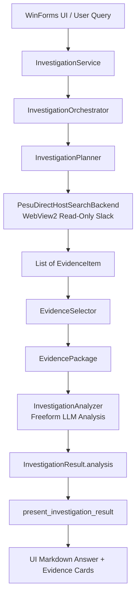
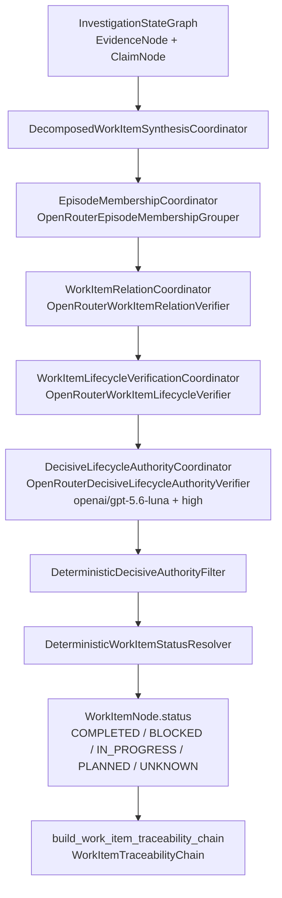
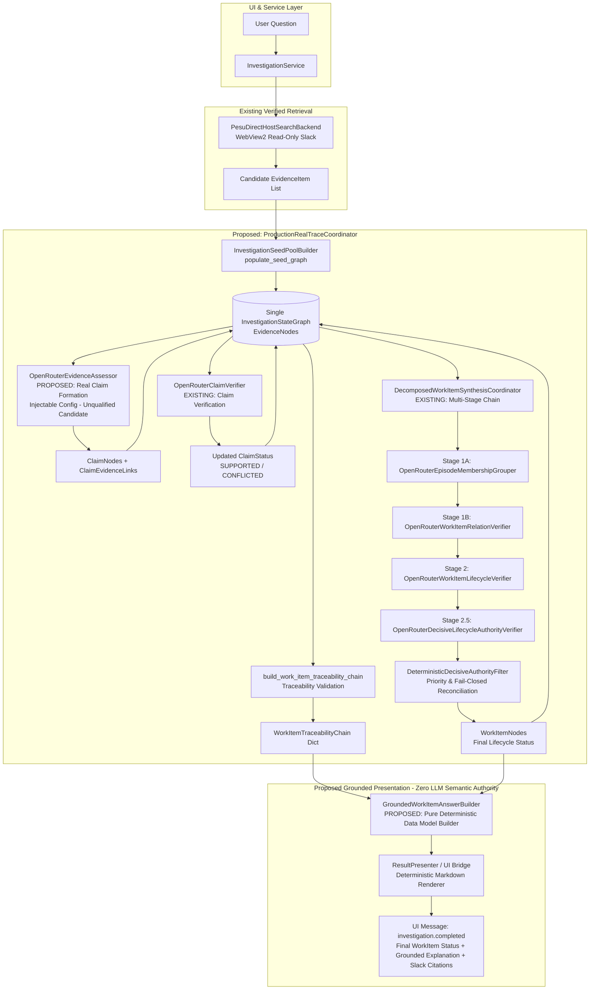

# PESU Agent — Phase 13.5D: Real Production Trace Integration Design Specification

> **Status**: PROPOSED (Design & Static Audit Only — No Implementation / No Live Actions)  
> **Author**: Antigravity  
> **Date**: 2026-09-14 (Refined Post-Review)  
> **Target Branch / Workspace**: `c:\Users\HEUM\Documents\pesu-agent`  
> **Prerequisites**: Phase 13.5C AR3 Closed (`COMPOSED_WORKITEM_E2E_VERDICT = FINAL_PASS`, `SAFE_TO_BEGIN_PHASE_13_5D = true`)

---

## 1. Purpose

The objective of **Phase 13.5D (Real Production Trace Integration)** is to bridge PESU's existing, verified read-only Slack retrieval infrastructure with the frozen, qualified multi-stage WorkItem reasoning pipeline (Stages 1A, 1B, 2, 2.5 + Downstream Reconciliation + Evidence-Backed Traceability) into an authoritative, end-to-end production flow.

Upon full user-facing qualification of Phase 13.5D:
1. The **new WorkItem pipeline becomes the sole production authority** for answering user inquiries about task status, blockers, and decisions.
2. The legacy `InvestigationAnalyzer` path is permanently retired from semantic status authority.
3. The final user-facing answer is strictly grounded in and projected from verifiable `WorkItemNode` states and their associated `WorkItemTraceabilityChain`s back to canonical Slack message permalinks.
4. If the new pipeline cannot safely establish a definitive status due to contradictory evidence, material uncertainty, or missing claims, the system **fails closed to `UNKNOWN`**—the legacy analyzer is strictly forbidden from guessing or overriding an uncertain outcome.
5. **Production Cutover Guard**: `InvestigationService` production routing is switched to the new pipeline **only after the entire end-to-end user-facing chain (including grounded answer presentation) passes qualification**.

---

## 2. Current Production Architecture

The current production user-facing pipeline operates through `InvestigationService` and the legacy `InvestigationOrchestrator`:



### Key Production Components in Repository:
* **`src/pesu_agent/ui/investigation_service.py`**:
  * Manages background investigation worker (`ThreadPoolExecutor(max_workers=1)`).
  * Manages credentials (`CredentialStore`) and user consent (`SessionConsentManager`).
  * In `_get_or_create_orchestrator()`, instantiates:
    * `PesuDirectHostSearchBackend` via `create_slack_search_backend(SlackSearchConfig(backend_kind=SlackBackendKind.WEBVIEW_DIRECT))`.
    * `OpenRouterProvider()`.
    * `InvestigationOrchestrator(provider, search_backend, config)`.
  * In `_run_investigation_worker()`, executes `orchestrator.run_investigation()`, checks terminal state, and calls `present_investigation_result()`.
* **`src/pesu_agent/investigation/orchestrator.py`**:
  * Orchestrates search queries via `InvestigationPlanner`.
  * Gathers `EvidenceItem` instances via `SearchBackend`.
  * Selects top evidence via `EvidenceSelector`.
  * Feeds `EvidencePackage` into `InvestigationAnalyzer.analyze()`.
  * Generates `InvestigationResult` containing `AnalysisResult(summary, confirmed_facts, assessment)`.
* **`src/pesu_agent/ui/result_presenter.py`**:
  * Formats `present_investigation_result(result)`:
    * Assembles `answer` from `result.analysis.summary`, `result.analysis.confirmed_facts`, and `result.analysis.assessment`.
    * Formats `evidence_cards` from `result.evidence_package.evidence_items`.

---

## 3. Current Qualified WorkItem Architecture

Qualified in Phase 13.5C AR3, the decomposed WorkItem reasoning pipeline operates as an integrated, deterministic state machine over `InvestigationStateGraph`:



### Frozen Components & Qualified Configurations:
* **Stage 1A (Membership)**: `EpisodeMembershipCoordinator` with `OpenRouterEpisodeMembershipGrouper` (Qualified in 13.5C AR3-R3A).
* **Stage 1B (Relation)**: `WorkItemRelationCoordinator` with `OpenRouterWorkItemRelationVerifier` (Qualified in 13.5C AR3-R3B).
* **Stage 2 (Lifecycle)**: `WorkItemLifecycleVerificationCoordinator` with `OpenRouterWorkItemLifecycleVerifier` (Qualified in 13.5C AR2).
* **Stage 2.5 (Decisive Authority)**: `DecisiveLifecycleAuthorityCoordinator` with `OpenRouterDecisiveLifecycleAuthorityVerifier`:
  * `model`: `openai/gpt-5.6-luna` (**FROZEN**)
  * `reasoning_effort`: `high` (**FROZEN**)
  * `temperature`: `0.0` (**FROZEN**)
  * Candidate Independence rule: Strictly enforced; sibling conflict does not demote independent authority.
* **Downstream Reconciliation**: `DeterministicDecisiveAuthorityFilter`:
  * Priority: `BLOCKER > COMPLETION > PROGRESS > PLAN > UNKNOWN`.
  * Coexistence: Multiple `CONFIRMED` links coexist without mutation or erasure.
  * Fail-closed: `CONTRADICTION` or material `UNCERTAIN` authority collapses final status to `UNKNOWN`.
* **Traceability**: `build_work_item_traceability_chain()` exposes full chain: `WorkItemNode` → `DecisiveAuthorityDecision` → `WorkItemLifecycleSignal` → `WorkItemClaimRelation` → `WorkItemEpisodeMembership` → `ClaimNode` → `EvidenceNode` → `canonical_permalink`.

---

## 4. Verified Integration Gaps (Static Audit Findings)

The static code audit evaluated each boundary between Real Slack retrieval and the qualified reasoning pipeline:

| Pipeline Transition | Current Repo Status | Implementation Source in Repository | Action Required in Phase 13.5D |
| :--- | :---: | :--- | :--- |
| **1. Real Slack Retrieval** | `CONFIRMED` | [`search_backend_factory.py`](file:///c:/Users/HEUM/Documents/pesu-agent/src/pesu_agent/search/slack_backend_factory.py), [`pesu_webview_host.py`](file:///c:/Users/HEUM/Documents/pesu-agent/src/pesu_agent/runtime/pesu_webview_host.py) | **Reuse as-is**: Production `PesuDirectHostSearchBackend` is verified and operational. |
| **2. `EvidenceItem` → `EvidenceNode`** | `CONFIRMED` | [`context_expansion.py`](file:///c:/Users/HEUM/Documents/pesu-agent/src/pesu_agent/investigation/context_expansion.py#L153-L250) (`InvestigationSeedPoolBuilder.populate_seed_graph`) | **Reuse as-is**: Ingests, canonically dedupes, scopes, and populates `graph.evidence_nodes`. |
| **3. `EvidenceNode` → real `ProposedClaim`** | **`MISSING`** | [`gap_assessment.py`](file:///c:/Users/HEUM/Documents/pesu-agent/src/pesu_agent/investigation/gap_assessment.py#L771-L800) defines `InvestigationEvidenceAssessor`, but **only `StubEvidenceAssessor` exists**. | **PROPOSED NEW ADAPTER**: Implement `OpenRouterEvidenceAssessor` conforming to `InvestigationEvidenceAssessor` protocol with **injectable configuration** (not yet qualified). |
| **4. Real Claim Verification** | `CONFIRMED` | [`claim_verification.py`](file:///c:/Users/HEUM/Documents/pesu-agent/src/pesu_agent/investigation/claim_verification.py#L290-L400) (`OpenRouterClaimVerifier`) | **Reuse as-is**: Fully qualified in Phase 13.4B with `openai/gpt-5.6-luna`. |
| **5. Claim → Stage 1A** | `CONFIRMED` | [`workitem_synthesis.py`](file:///c:/Users/HEUM/Documents/pesu-agent/src/pesu_agent/investigation/workitem_synthesis.py#L3418) (`OpenRouterEpisodeMembershipGrouper`) | **Reuse as-is**: Formally frozen and qualified. |
| **6. Stage 1A → Stage 1B** | `CONFIRMED` | [`workitem_synthesis.py`](file:///c:/Users/HEUM/Documents/pesu-agent/src/pesu_agent/investigation/workitem_synthesis.py#L3981) (`OpenRouterWorkItemRelationVerifier`) | **Reuse as-is**: Formally frozen and qualified. |
| **7. Stage 1B → Stage 2** | `CONFIRMED` | [`workitem_synthesis.py`](file:///c:/Users/HEUM/Documents/pesu-agent/src/pesu_agent/investigation/workitem_synthesis.py#L2210) (`OpenRouterWorkItemLifecycleVerifier`) | **Reuse as-is**: Formally frozen and qualified. |
| **8. Stage 2 → Stage 2.5** | `CONFIRMED` | [`workitem_synthesis.py`](file:///c:/Users/HEUM/Documents/pesu-agent/src/pesu_agent/investigation/workitem_synthesis.py#L4579) (`OpenRouterDecisiveLifecycleAuthorityVerifier`) | **Reuse as-is**: Qualified with `openai/gpt-5.6-luna + high`. |
| **9. Stage 2.5 → Final WorkItem** | `CONFIRMED` | [`workitem_synthesis.py`](file:///c:/Users/HEUM/Documents/pesu-agent/src/pesu_agent/investigation/workitem_synthesis.py#L1182) (`DeterministicDecisiveAuthorityFilter`) | **Reuse as-is**: Reconciles priority and fail-closed rules. |
| **10. Final WorkItem → Trace Bundle**| `CONFIRMED` | [`workitem_synthesis.py`](file:///c:/Users/HEUM/Documents/pesu-agent/src/pesu_agent/investigation/workitem_synthesis.py#L70-L160) (`build_work_item_traceability_chain`) | **Reuse as-is**: Verified 100% complete in 13.5C AR3. |
| **11. Trace Bundle → User Answer** | **`MISSING`** | [`result_presenter.py`](file:///c:/Users/HEUM/Documents/pesu-agent/src/pesu_agent/ui/result_presenter.py) currently only renders legacy `AnalysisResult` from old `InvestigationAnalyzer`. | **PROPOSED DETERMINISTIC BUILDER**: Implement `GroundedWorkItemAnswerBuilder` to project structured answer data deterministically from WorkItem states and traceability chains without freeform LLM guessing. |

---

## 5. Target Architecture

The target production architecture introduces a single thin orchestration coordinator (`ProductionRealTraceCoordinator`) that executes the unified pipeline across a single `InvestigationStateGraph`, terminating in a deterministic grounded answer builder:



---

## 6. Component Responsibilities

### 6.1. Reused Existing Components (Zero Semantic Changes)
1. **`PesuDirectHostSearchBackend`** ([`pesu_webview_host.py`](file:///c:/Users/HEUM/Documents/pesu-agent/src/pesu_agent/runtime/pesu_webview_host.py)):
   * Performs read-only search and candidate collection in the isolated secondary WebView2 window.
   * Emits `list[EvidenceItem]` with author, text, timestamp, and message permalink.
2. **`InvestigationSeedPoolBuilder`** ([`context_expansion.py`](file:///c:/Users/HEUM/Documents/pesu-agent/src/pesu_agent/investigation/context_expansion.py)):
   * Transforms `list[EvidenceItem]` into primary `EvidenceNode` instances.
   * Enforces canonical deduplication and authoritative temporal/actor scope filtering.
   * Populates `graph.evidence_nodes`.
3. **`OpenRouterClaimVerifier`** ([`claim_verification.py`](file:///c:/Users/HEUM/Documents/pesu-agent/src/pesu_agent/investigation/claim_verification.py)):
   * Verifies factual entailment of claims against candidate evidence (`SUPPORTS`, `CORROBORATES`, `CONTRADICTS`, `CONTEXT_FOR`).
   * Evaluates attribution strength (`DIRECT`, `INDIRECT`, `CONTEXT_ONLY`).
4. **`DecomposedWorkItemSynthesisCoordinator`** ([`workitem_synthesis.py`](file:///c:/Users/HEUM/Documents/pesu-agent/src/pesu_agent/investigation/workitem_synthesis.py)):
   * Executes Stages 1A, 1B, 2, and 2.5 using qualified real model adapters:
     * `OpenRouterEpisodeMembershipGrouper` (1A)
     * `OpenRouterWorkItemRelationVerifier` (1B)
     * `OpenRouterWorkItemLifecycleVerifier` (2)
     * `OpenRouterDecisiveLifecycleAuthorityVerifier` (2.5)
   * Executes downstream resolver `DeterministicDecisiveAuthorityFilter`.
   * Computes final `WorkItemNode.status` and `traceability_chains`.

### 6.2. Proposed Minimal Wiring & Adapters (Phase 13.5D Additions)

#### 1. `OpenRouterEvidenceAssessor` (`[PROPOSED]`)
* **Role**: Real model adapter implementing abstract class `InvestigationEvidenceAssessor` ([`gap_assessment.py`](file:///c:/Users/HEUM/Documents/pesu-agent/src/pesu_agent/investigation/gap_assessment.py#L771)).
* **Input**: `AssessmentPayload` (contains question, actor scope summary, temporal scope summary, list of `AssessmentEvidenceItem`).
* **Output**: `InvestigationAssessment` containing `list[ProposedClaim]`.
* **Runtime Configuration Architecture (Injectable, Non-Frozen)**:
  * Parameters `provider`, `model`, `reasoning_effort`, `temperature` **must remain strictly injectable** through constructor parameters or configuration objects.
  * **Explicit Governance Notice**: This adapter is **NOT yet declared as a production-qualified configuration**. Unlike Stage 2.5 (which is frozen at `openai/gpt-5.6-luna`, `reasoning_effort=high`, `temperature=0.0`), `OpenRouterEvidenceAssessor` has not completed dedicated real-model qualification.
  * **Initial Qualification Candidate**: `model="openai/gpt-5.6-luna"`, `reasoning_effort="medium"`, `temperature=0.0`. This is designated solely as a candidate baseline to be qualified, distinct from any frozen production standard.
  * **Agent Environment Separation**: The Antigravity development environment (Gemini 3.8 Flash / reasoning high) is an external execution environment and has zero relationship to the PESU runtime model configuration.
* **Prompt Contract**: Objective extraction of empirical factual propositions from evidence text. Explicit prohibition of speculative or untraced propositions.
* **Untrusted Data Boundary**: Source Slack message texts are passive evaluation data. Embedded prompt injection attempts are strictly ignored.

#### 2. `ProductionRealTraceCoordinator` (`[PROPOSED]`)
* **Role**: Thin orchestration coordinator replacing `InvestigationOrchestrator` in production.
* **Responsibility**: Sequential wiring only: search execution → seed pool ingestion → claim assessment → claim verification → WorkItem decomposition → traceability validation → grounded answer construction.
* **Constraint**: Contains **zero new domain semantic rules**; acts solely as a sequential flow coordinator.

#### 3. `GroundedWorkItemAnswerBuilder` (`[PROPOSED]`)
* **Role**: Pure deterministic data builder that projects validated `WorkItemNode` and `WorkItemTraceabilityChain` into structured grounded answer data.
* **Input**:
  * Final `WorkItemNode.status`
  * Decisive authority decision(s)
  * Lifecycle signal(s)
  * Relation and episode membership (where needed)
  * Governing Claim references and statements
  * Evidence references and snippets
  * Canonical Slack permalinks
* **Output**:
  * Structured grounded answer data (e.g. `GroundedWorkItemAnswerPayload`).
* **Strict Semantic Invariants**:
  * **Zero Semantic Authority**: This component never decides status, reinterprets lifecycle, or alters the graph.
  * **YAGNI Compliance (Zero Freeform LLM in Phase 13.5D)**: Phase 13.5D does NOT introduce a freeform LLM generation step for user answers. A deterministic template/builder is used to guarantee 100% factual grounding and eliminate any risk of hallucinated task completion. (Any future LLM wording polish layer must remain a non-authoritative stylistic decorator subject to separate qualification).
  * **Fail-Closed Presentation**: When status is `UNKNOWN`, the builder formats an explicit non-speculative statement that Slack evidence is either insufficient, ambiguous, or contradictory, and points to the relevant messages without guessing completion.
  * **Renderer Integration**: Output data is rendered to Markdown/UI cards directly by extending `ResultPresenter` or through a thin deterministic renderer.

---

## 7. Data Flow & Boundary Transformations

| Stage | Input Data | Processing Entity | Output Data | Invariant / Boundary Rule |
| :--- | :--- | :--- | :--- | :--- |
| **Search** | `UserQuestion(question)` | `PesuDirectHostSearchBackend` | `list[EvidenceItem]` | `SLACK_WRITE_ACTIONS = 0` |
| **Seed Ingestion** | `list[EvidenceItem]` | `InvestigationSeedPoolBuilder` | `InvestigationStateGraph.evidence_nodes` | Deduplicated canonically, no raw author Slack IDs |
| **Claim Formation**| `AssessmentPayload` | `OpenRouterEvidenceAssessor` | `list[ProposedClaim]` | Injectable config (unqualified candidate); `semantic_type` required |
| **Claim Verification**| `ClaimVerificationPayload` | `OpenRouterClaimVerifier` | `ClaimVerificationAssessment` | Direct support requires `DIRECT` strength and verified actor |
| **Stage 1A (Membership)** | `WorkItemSynthesisPayload` | `OpenRouterEpisodeMembershipGrouper` | `EpisodeMembershipProposal` | WorkItems capped at 5; explicit claim accounting |
| **Stage 1B (Relation)** | `WorkItemRelationVerificationPayload` | `OpenRouterWorkItemRelationVerifier` | `WorkItemRelationProposal` | Exactly 1 relation per member/context claim |
| **Stage 2 (Lifecycle)** | `WorkItemLifecycleVerificationPayload` | `OpenRouterWorkItemLifecycleVerifier` | `WorkItemLifecycleVerificationProposal` | Signals: `COMPLETION`, `PROGRESS`, `PLAN`, `BLOCKER`, `CHURN`, `ABANDONED` |
| **Stage 2.5 (Authority)** | `DecisiveLifecycleAuthorityPayload` | `OpenRouterDecisiveLifecycleAuthorityVerifier` | `DecisiveLifecycleAuthorityProposal` | **FROZEN CONFIG**: `openai/gpt-5.6-luna + high`; Candidate Independence |
| **Reconciliation**| Coexisting confirmed links | `DeterministicDecisiveAuthorityFilter` | `WorkItemNode.status` | Priority: `BLOCKER > COMPLETION > PROGRESS > PLAN > UNKNOWN` |
| **Traceability** | `InvestigationStateGraph` | `build_work_item_traceability_chain` | `WorkItemTraceabilityChain` | `EVERY_FINAL_STATE_HAS_TRACEABLE_CLAIM_EVIDENCE = true` |
| **Answer Building** | `WorkItemTraceabilityChain` + `WorkItemNode` | `GroundedWorkItemAnswerBuilder` | `GroundedWorkItemAnswerPayload` | **Deterministic data builder**; zero freeform LLM guessing |
| **Presentation** | `GroundedWorkItemAnswerPayload` | `ResultPresenter` (or thin renderer) | UI message payload (`answer`, `evidence_cards`) | Pure deterministic representation; never overrides `UNKNOWN` |

---

## 8. Graph Ownership & Traceability Contract

### 8.1. Single Graph Lifecycle Rule
A single `InvestigationStateGraph` instance is created at the start of an investigation and passed by reference through every stage:
```text
InvestigationStateGraph created
  ├── SeedPoolBuilder populates evidence_nodes
  ├── ClaimAssessor & ClaimVerifier populate claim_nodes & claim_evidence_links
  ├── Stage 1A creates work_items & initial work_item_claim_links
  ├── Stage 1B updates work_item_claim_links.relation
  ├── Stage 2 updates work_item_claim_links.lifecycle_signal
  ├── Stage 2.5 updates work_item_claim_links.decisive_authority
  ├── Downstream Resolver updates work_items.status
  └── Traceability Chain reads exact graph structure
```
**Strictly Forbidden**:
* Exporting claims to a separate DTO, destroying the graph, and reconstructing a new graph.
* Lossy transformations that drop claim-to-evidence links.

### 8.2. Traceability Invariant
Every substantive statement in the user answer must be fully resolvable through the following provenance path:
```text
User Answer Text
  └── WorkItemNode.status
        └── WorkItemClaimLink (decisive_authority == CONFIRMED)
              ├── lifecycle_signal (COMPLETION / BLOCKER / PROGRESS / PLAN)
              ├── relation (PRIMARY / OUTCOME / FOLLOW_UP)
              ├── episode_membership (MEMBER / CONTEXT)
              └── ClaimNode (claim_id)
                    └── ClaimEvidenceLink (relation == SUPPORTS, attribution_strength == DIRECT)
                          └── EvidenceNode (evidence_id)
                                └── canonical_permalink (https://slack.com/archives/...)
```
If `build_work_item_traceability_chain()` finds that any governing claim lacks a supporting `EvidenceNode` or has an unverified link, `trace.is_traceable` is `False`, forcing the WorkItem into an unverified/fail-closed presentation.

---

## 9. Failure & Fail-Closed Behavior

The production system must adhere to non-negotiable fail-closed invariants:

1. **No Evidence Found**:
   * If Slack search returns 0 relevant evidence items, the system immediately dispatches `NO_EVIDENCE_ANSWER_TEXT` without invoking LLMs.
2. **Ambiguous or Contradictory Evidence**:
   * If claims conflict (e.g. one claim asserts deployment succeeded, another asserts deployment failed), `WorkItemClaimRelation.CONTRADICTION` is established.
   * Downstream resolver immediately assigns `WorkItemStatus.UNKNOWN`.
   * **The presentation layer must explicitly state that conflicting reports exist**, rather than picking a winner.
3. **Material Uncertainty**:
   * If a decisive candidate (such as a blocker) receives `DecisiveAuthorityDecision.UNCERTAIN` from Stage 2.5, the resolver fails closed to `WorkItemStatus.UNKNOWN`.
4. **Invalid Provider Output**:
   * Malformed JSON, missing candidate evaluations, or schema violations from any OpenRouter adapter trigger safe error handling and fail closed.
5. **No Speculative Override**:
   * Legacy `InvestigationAnalyzer` must **never** be invoked as a fallback when the new pipeline yields `UNKNOWN`.
   * `UNKNOWN` is a first-class, safe, and valid final result.

---

## 10. Provider Governance & Budget Boundaries

All LLM provider interactions within Phase 13.5D are strictly budgeted and auditable:

| Stage / Component | Model Configuration | Reasoning Effort | Temperature | Invariant / Governance Role |
| :--- | :--- | :---: | :---: | :--- |
| **Claim Assessor** (`[PROPOSED]`) | Injectable Config (Candidate: `openai/gpt-5.6-luna`) | Injectable Config (Candidate: `medium`) | `0.0` | **UNQUALIFIED CANDIDATE CONFIG**: 1 call per investigation; extracts empirical claims |
| **Claim Verifier** (`OpenRouterClaimVerifier`) | `openai/gpt-5.6-luna` | `medium` | `0.0` | Bounded calls ($\le 2$ batches); validates claim-evidence support |
| **Stage 1A (Membership)** | `openai/gpt-5.6-luna` | `medium` | `0.0` | 1 call per investigation; groups claims into WorkItems |
| **Stage 1B (Relation)** | `openai/gpt-5.6-luna` | `medium` | `0.0` | 1 call per synthesized WorkItem |
| **Stage 2 (Lifecycle)** | `openai/gpt-5.6-luna` | `medium` | `0.0` | 1 call per synthesized WorkItem |
| **Stage 2.5 (Decisive Authority)** | `openai/gpt-5.6-luna` | `high` | `0.0` | **FROZEN QUALIFIED CONFIGURATION**: High reasoning effort, 1 call per WorkItem |
| **Answer Synthesis** (`[PROPOSED]`) | **NONE (Deterministic Builder)** | N/A | N/A | **YAGNI RULE**: Pure deterministic data projection; zero LLM calls for answer synthesis |

* **Single Successful Generation Per Inference**:
  `ONE_SUCCESSFUL_MODEL_GENERATION_PER_LOGICAL_INFERENCE = true`. Retries are permitted only for transient HTTP 5xx errors, never for semantic mismatches.
* **Token & Privacy Protection**:
  Raw Slack user IDs, bot tokens, and personal credentials are never exposed in prompt text. All evidence text is bounded to `max_evidence_chars` per item.

---

## 11. Slack Read-Only Safety Protocol

Throughout Phase 13.5D integration and testing:
```text
SLACK_WRITE_ACTIONS = 0
```
Strict prohibitions:
* Zero `chat.postMessage` or UI message dispatch.
* Zero message edits, deletions, reactions, or thread replies.
* Zero workspace profile, channel, or user mutations.
* Zero interaction with the user's primary desktop Slack window (all search occurs strictly inside the isolated secondary hidden/background WebView2 host window).

---

## 12. Offline Qualification Strategy (Phase 13.5D Step 1)

Prior to running any live Slack queries, Phase 13.5D requires an offline, end-to-end integration test harness:
1. **Production-Shaped Fixtures**:
   * Construct `list[EvidenceItem]` fixtures representing realistic enterprise Slack conversations (e.g. migration rollout, outage triage, ambiguous spec discussion).
   * Feed into `ProductionRealTraceCoordinator` with stubbed or recorded model responses.
2. **Offline Verification Suite**:
   * Verify complete end-to-end data flow from `EvidenceItem` through to `GroundedWorkItemAnswerPayload`.
   * Verify all 5 fail-closed conditions (unknown membership, unknown relation, unknown lifecycle, contradictory signals, material uncertainty).
   * Verify that zero live network requests occur (`LIVE_SLACK_ACTIONS = 0`).

---

## 13. Bounded Live Qualification Strategy (Phase 13.5D Step 2)

Once offline qualification passes, a bounded live qualification session evaluates the integrated system against 3 distinct live scenarios in the target corporate Slack environment:

### Scenario 1: Clear Completion / Progress
* **User Query**: Inquiry regarding an acknowledged, completed project task (e.g. release deployment, database index creation).
* **Expected Outcome**: Real Slack retrieval finds authoritative announcement; Claim Assessor extracts completion proposition; Claim Verifier confirms support; Stages 1A–2.5 assign `PRIMARY` + `COMPLETION` + `CONFIRMED`; Final WorkItem resolves to `COMPLETED`; Answer links to the exact Slack permalink.

### Scenario 2: Completion + Active Blocker Coexistence
* **User Query**: Inquiry regarding a feature rollout where implementation is finished but deployment is halted by an active dependency or security review.
* **Expected Outcome**: Both completion claim and blocker claim are confirmed; Downstream resolver enforces `BLOCKER > COMPLETION`; Final WorkItem resolves to `BLOCKED`; Answer clearly explains that coding is complete but release is blocked, citing both threads.

### Scenario 3: Insufficient / Contradictory Evidence (Mandatory Fail-Closed)
* **User Query**: Inquiry where Slack discussions contain unresolved disagreements, speculative rumors, or no verifiable confirmation.
* **Expected Outcome**: Claims are marked conflicted or decisive authority is marked `UNCERTAIN`; Downstream resolver resolves to `UNKNOWN`; Presentation layer states the issue is unresolved and points to the ambiguous messages. **Zero hallucinated completion allowed.**

---

## 14. Production Cutover Strategy

### 14.1. Strict Prerequisite: User-Facing End-to-End PASS
Production cutover in `InvestigationService` is performed **ONLY AFTER the full user-facing end-to-end pipeline passes qualification**.

**Strictly Forbidden Sequence**:
```text
WorkItem pipeline PASS
→ InvestigationService cutover
→ user answer wiring
(STRICTLY FORBIDDEN)
```

**Mandatory Qualification & Cutover Sequence**:
```text
1. Real Slack retrieval (PesuDirectHostSearchBackend)
2. Evidence enters graph (InvestigationSeedPoolBuilder)
3. Real ProposedClaim formation (OpenRouterEvidenceAssessor)
4. Real Claim verification (OpenRouterClaimVerifier)
5. Stage 1A Episode Membership (OpenRouterEpisodeMembershipGrouper)
6. Stage 1B Relation (OpenRouterWorkItemRelationVerifier)
7. Stage 2 Lifecycle (OpenRouterWorkItemLifecycleVerifier)
8. Stage 2.5 Decisive Authority (OpenRouterDecisiveLifecycleAuthorityVerifier)
9. Downstream Reconciliation (DeterministicDecisiveAuthorityFilter)
10. Final WorkItem State (WorkItemNode.status)
11. Complete Traceability (build_work_item_traceability_chain)
12. Grounded user-facing answer (GroundedWorkItemAnswerBuilder + ResultPresenter)
13. Full User-Facing E2E Qualification PASS
14. InvestigationService production cutover
```

### 14.2. Cutover Mechanism
1. **Routing Switch in `InvestigationService`**:
   * Once full user-facing E2E qualification passes, update `_run_investigation_worker()` to dispatch through `ProductionRealTraceCoordinator` and `GroundedWorkItemAnswerBuilder` instead of `InvestigationOrchestrator`.
2. **Safe Fallback & Coexistence during Validation**:
   * Until qualification passes, `InvestigationService` retains its existing path.
   * Legacy `InvestigationOrchestrator` and `InvestigationAnalyzer` source files remain for historical test compatibility, but are detached from the active production UI dispatch route.
   * Legacy analyzer is never invoked as a fallback for `UNKNOWN` states after cutover.

---

## 15. Frozen Artifacts & Non-Goals

### 15.1. Frozen Artifacts (Strictly Immutable)
* Stage 1A normative contract, prompt, schema, and thresholds.
* Stage 1B normative contract, prompt, schema, and thresholds.
* Stage 2 normative contract, prompt, schema, and thresholds.
* Stage 2.5 normative contract, system prompt, and qualified model (`openai/gpt-5.6-luna + high`).
* Deterministic downstream priority resolver rules (`BLOCKER > COMPLETION > PROGRESS > PLAN > UNKNOWN`).
* Historical qualification test suites and V10 benchmarks.

### 15.2. Non-Goals (YAGNI)
* Do NOT rewrite Slack search or implement new DOM automation primitives.
* Do NOT redesign UI components or change WinForms bridge architecture.
* Do NOT introduce external vector databases, persistent knowledge graphs, or caching servers.
* Do NOT re-qualify frozen upstream stages.
* Do NOT allow the legacy analyzer to act as an ungrounded fallback.
* Do NOT introduce a freeform LLM generation layer for user-facing answers in Phase 13.5D.

---

## 16. Acceptance Criteria & Gate-Bearing Metrics

Phase 13.5D closeout requires satisfying all of the following mechanical criteria:

```text
REAL_SLACK_RETRIEVAL_USED = true
REAL_EVIDENCE_ENTERED_STATE_GRAPH = true
REAL_CLAIM_FORMATION_USED = true
REAL_CLAIM_VERIFICATION_USED = true

REAL_STAGE1A_USED = true
REAL_STAGE1B_USED = true
REAL_STAGE2_USED = true
REAL_STAGE25_USED = true

EVERY_FINAL_STATE_TRACEABLE_TO_REAL_SLACK = true
DETERMINISTIC_GROUNDED_ANSWER_BUILDER_USED = true
USER_FACING_ANSWER_GROUNDED_IN_FINAL_WORKITEMS = true
FULL_USER_FACING_E2E_QUALIFIED_BEFORE_CUTOVER = true

UNKNOWN_FAIL_CLOSED = true

SLACK_WRITE_ACTIONS = 0
FROZEN_STAGE_ARTIFACT_MUTATIONS = 0
GATE_BEARING_REGRESSION = PASS

PHASE_13_5D_REAL_PRODUCTION_TRACE_VERDICT = FINAL_PASS
```

---

## 17. Known Risks & Mitigations

| Risk | Severity | Mitigation Strategy |
| :--- | :---: | :--- |
| **High Multi-Stage Latency** | Medium | Execute Stage 1B, Stage 2, and Stage 2.5 concurrently across independent WorkItems using `asyncio.gather()`. Batch claim verification into minimal logical calls. |
| **Empty Search Results on Obscure Queries** | Low | `InvestigationSeedPoolBuilder` validates candidate counts; if empty, immediately returns clean Korean guidance without invoking LLMs. |
| **Prompt Injection via Slack Text** | High | All message content is treated as untrusted data within dedicated XML/markdown data blocks. System prompts explicitly instruct models to ignore instructions in evidence. |
| **Stale Slack Permalinks** | Low | Validate canonical permalinks using `validate_citation_permalink()` before rendering UI citation cards. |
| **Model Demotion of Blockers** | Medium | Frozen Stage 2.5 Luna-High configuration has 100% qualified safety on blocker detection; Candidate Independence rule ensures sibling claims cannot suppress blockers. |
| **Hallucination in Answer Synthesis** | Low | Mitigated completely by using deterministic `GroundedWorkItemAnswerBuilder` rather than freeform LLM answer synthesis in Phase 13.5D. |
